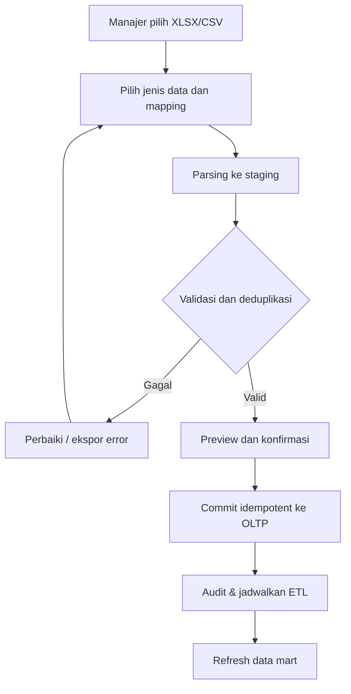
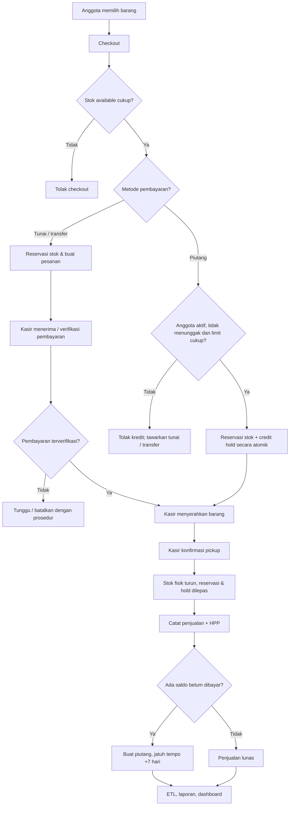
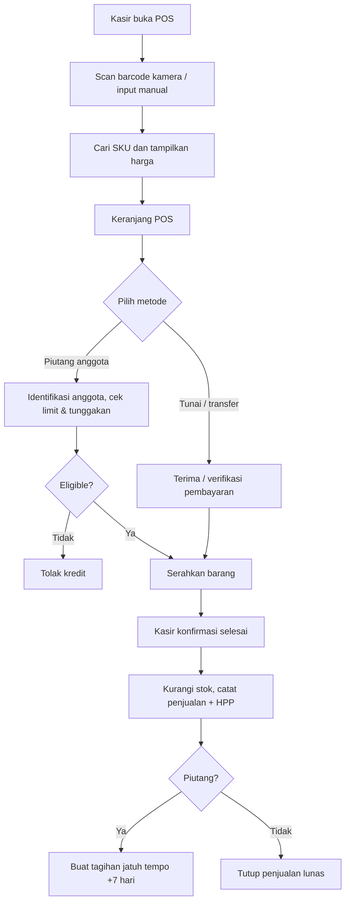
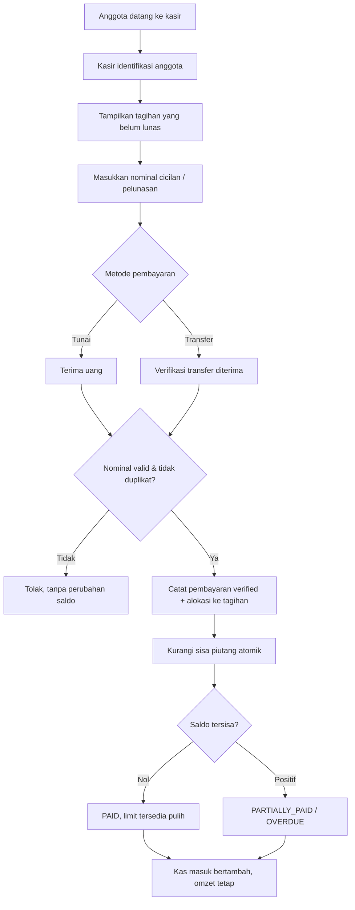
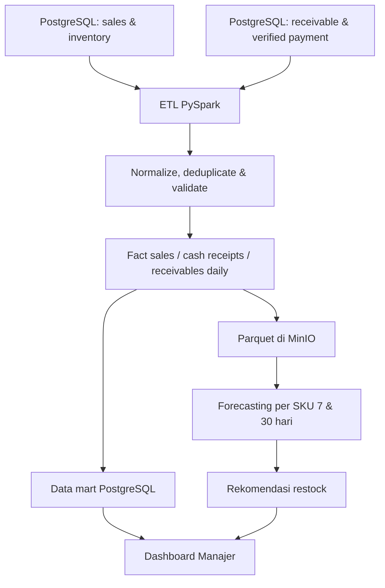
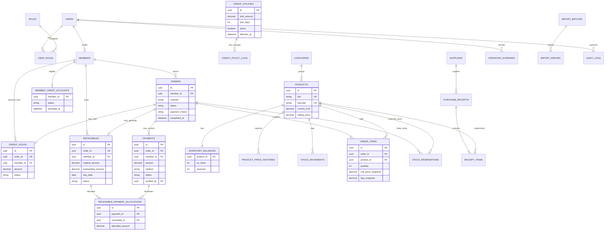
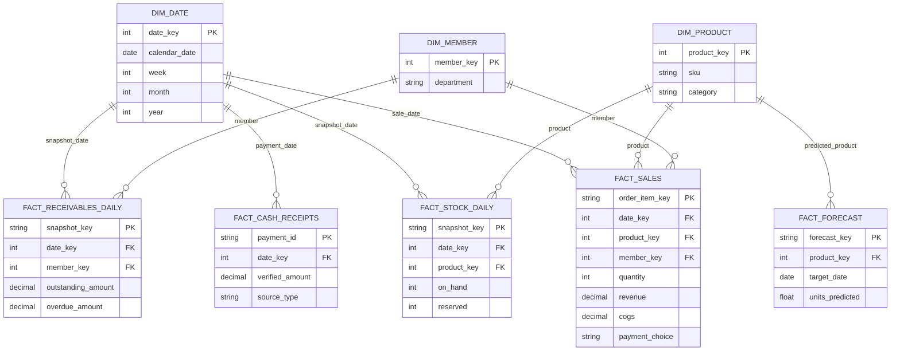

# PRODUCT REQUIREMENTS DOCUMENT (PRD)
# KOPERADATA — Sistem Koperasi Karyawan Berbasis Big Data & Predictive Analytics

| Metadata | Detail |
|---|---|
| Versi | 1.4 — Final kebijakan piutang |
| Tanggal | 16 November 2026 |
| Status | Baseline implementasi tim 5 PIC; kebijakan piutang FINAL, beberapa parameter non-piutang masih perlu ditentukan |
| Jenis produk | Aplikasi web responsif + pipeline data analitik |
| Jenis koperasi | Koperasi karyawan (penjualan barang/koperasi konsumsi) |
| Sumber data | Input manual, transaksi aplikasi, impor Excel/CSV historis |
| Sasaran akademik | Big Data 2: ETL PySpark, analisis historis, dan forecasting |

---

## 1. Ringkasan Eksekutif

**KOPERADATA** adalah aplikasi koperasi karyawan yang mengintegrasikan katalog dan pemesanan anggota, POS dengan pemindaian barcode kamera, manajemen produk/HPP/harga jual/persediaan, migrasi data Excel, pembayaran tunai/transfer/**piutang anggota**, pelaporan omzet-laba-kas-piutang, analitik Big Data, dan prediksi kebutuhan stok. Sistem menggunakan **tepat tiga peran RBAC**: **Anggota**, **Petugas/Kasir**, dan **Manajer**. Tidak terdapat peran Admin terpisah; fungsi administrasi dijalankan Manajer.

Model pemenuhan pesanan adalah **pickup only** (ambil langsung di koperasi), tanpa pengiriman. **Checkout mereservasi stok; tidak mengurangi stok fisik.** Stok fisik dan penjualan baru dibukukan ketika **Petugas/Kasir mengonfirmasi barang telah diserahkan (pickup atau POS)**; pembayaran harus **lunas** atau **fasilitas piutang sudah disetujui secara otomatis oleh aturan koperasi**. Piutang dicatat setelah serah terima, bukan saat checkout. Data operasional disimpan pada PostgreSQL, sementara ETL PySpark menyiapkan data historis untuk analitik dan forecasting permintaan 7/30 hari.

## 2. Masalah yang Ingin Diselesaikan

1. Data anggota, barang, persediaan, dan transaksi masih tersebar di Excel atau pencatatan manual.
2. Pemesanan oleh karyawan dan proses pengambilan barang belum terintegrasi dengan stok.
3. Laporan omzet/laba sulit diperoleh secara cepat, konsisten, dan lintas periode.
4. Pengurus sulit mengetahui barang terlaris, stok berlebih/kritis, dan produk kurang laku.
5. Pembelian ulang persediaan belum ditopang data permintaan historis.
6. Penjualan kredit anggota dan cicilannya belum terkelola, menyebabkan risiko piutang tidak tercatat dan laporan kas tercampur dengan omzet.

## 3. Tujuan dan Ukuran Keberhasilan

### 3.1 Tujuan produk

- Menyatukan transaksi dan master data koperasi dalam satu sistem.
- Memungkinkan karyawan memesan barang lalu membayar dan mengambilnya di koperasi.
- Menjamin stok tidak terjual melebihi stok tersedia, walaupun checkout bersamaan.
- Menyediakan laporan omzet, HPP, laba kotor, biaya operasional, estimasi laba bersih, pembayaran, saldo piutang, dan tunggakan per periode.
- Mengimpor Excel/CSV historis secara terkontrol tanpa merusak stok berjalan.
- Menyediakan pipeline ETL PySpark, data mart, dashboard analitik, dan prediksi permintaan barang.

### 3.2 Kriteria keberhasilan MVP

- Seluruh alur pembelian anggota (lunas atau piutang) dan pembelian langsung POS (termasuk barcode kamera) berhasil dari awal hingga akhir.
- Transaksi stok selalu konsisten: `available = on_hand - reserved`, dengan kedua nilai tidak negatif.
- Konfirmasi pickup yang dikirim dua kali tidak menggandakan stok keluar, omzet, maupun piutang; pembayaran cicilan berulang dengan idempotency key tidak boleh menghasilkan pelunasan ganda.
- Impor ulang sumber historis yang sama tidak menggandakan transaksi; kesalahan per baris tercatat.
- Laporan per periode cocok dengan transaksi selesai, HPP/biaya, kas masuk, dan pergerakan piutang yang diverifikasi; pelunasan piutang tidak dihitung sebagai omzet baru.
- Pipeline ETL dapat dijalankan ulang (*idempotent*) dan menampilkan waktu pembaruan terakhir.
- Forecast 7/30 hari dihasilkan, dibandingkan terhadap baseline, dan menampilkan keterbatasan saat histori tidak cukup.
- Uji Big Data menghasilkan laporan waktu pemrosesan dataset bertingkat (contoh 10 ribu, 100 ribu, 1 juta baris sintetis).

## 4. Cakupan dan Batasan

### 4.1 Termasuk MVP

- Login, RBAC, manajemen pengguna/anggota.
- Produk, kategori, pemasok, harga beli dan harga jual.
- Stok fisik, reservasi, penerimaan stok, koreksi, dan audit stok.
- Katalog, keranjang, checkout, status pesanan, pickup.
- POS untuk pembelian langsung dengan scanner barcode melalui kamera HP/webcam dan fallback input manual.
- Pembayaran tunai/transfer manual **dan piutang anggota** dengan limit seragam, jatuh tempo tujuh hari kalender sejak penyerahan barang, serta cicilan/pelunasan tunai atau transfer melalui kasir.
- Impor produk, anggota, stok awal, dan histori penjualan melalui XLSX/CSV.
- Pencatatan HPP dan riwayat harga jual, biaya operasional, laporan keuangan penjualan serta piutang/aging.
- Dashboard operasional, laporan per hari/pekan/bulan/tahun, ekspor PDF/Excel.
- ETL batch PySpark, Parquet di MinIO, data mart PostgreSQL.
- Analitik produk/penjualan/persediaan/aktivitas anggota.
- Forecast 7 dan 30 hari, rekomendasi restock yang memerlukan persetujuan manusia.

### 4.2 Tidak termasuk MVP

- Pinjaman uang/simpan pinjam, simpanan wajib/pokok, penghitungan SHU (**piutang di MVP hanya berasal dari penjualan barang**).
- Potongan gaji karyawan, payroll, integrasi HRIS.
- Pengiriman kurir, logistik antar alamat, marketplace publik.
- Payment gateway, rekonsiliasi bank otomatis, akuntansi buku besar lengkap, bunga atau denda otomatis piutang.
- Pembelian restock otomatis tanpa review.
- Multi-cabang/multi-gudang (desain awal satu lokasi koperasi).

## 5. Aktor dan Hak Akses (RBAC)

**Hanya tiga role yang valid:** `MEMBER`, `CASHIER`, `MANAGER`. Satu akun boleh memiliki lebih dari satu dari ketiga role tersebut jika petugas/manajer juga menjadi anggota, tanpa menambah jenis role. Implementasi disarankan menggunakan tabel `roles` dan `user_roles`, lalu memeriksa *permission* di backend. Pengguna memilih konteks peran ketika memiliki lebih dari satu.

| Kemampuan | Anggota | Petugas/Kasir | Manajer |
|---|:---:|:---:|:---:|
| Login dan profil sendiri | Ya | Ya | Ya |
| Lihat katalog & ketersediaan stok | Ya | Ya | Ya |
| Checkout & riwayat pesanan sendiri | Ya | Hanya bila juga anggota | Hanya bila juga anggota |
| Bayar dan ambil pesanan sendiri | Ya | Hanya bila juga anggota | Hanya bila juga anggota |
| Lihat dan proses seluruh pesanan | Tidak | Ya | Ya |
| Verifikasi pembayaran & konfirmasi pickup | Tidak | Ya | Ya |
| POS pembelian langsung | Tidak | Ya | Ya |
| Penerimaan dan koreksi stok | Tidak | Ya, dibatasi izin | Ya |
| CRUD master produk/harga/pemasok | Tidak | Baca/terbatas | Ya |
| Impor Excel data historis dan master | Tidak | Tidak | Ya |
| Mengelola akun, role, dan anggota | Tidak | Tidak | Ya |
| Laporan operasional harian | Tidak | Ya, terbatas | Ya |
| Omzet, laba, laporan seluruh periode | Tidak | Tidak | Ya |
| Lihat limit dan tagihan piutang sendiri | Ya | Hanya saat pelayanan | Ya |
| Pilih pembayaran piutang (jika memenuhi syarat) | Ya | Ya untuk POS anggota | Ya sesuai operasional |
| Verifikasi pembayaran/cicilan piutang | Tidak | Ya | Ya |
| Atur limit piutang global, blokir/aktifkan fasilitas anggota | Tidak | Tidak | Ya |
| Lihat semua piutang, aging, dan tunggakan | Tidak | Terbatas untuk melayani | Ya |
| Big Data analytics & hasil forecast | Tidak | Tidak | Ya |
| Pengaturan sistem dan audit log penuh | Tidak | Tidak | Ya |

**Pembatasan:** Anggota hanya dapat membaca datanya sendiri, termasuk limit dan tagihan piutangnya. Petugas tidak dapat mengubah margin/biaya/manajemen peran. Untuk mencegah konflik kepentingan, konfirmasi pickup atas pesanan milik petugas sendiri harus dilakukan petugas lain atau manajer (rekomendasi kontrol).

## 6. Modul dan Kebutuhan Fungsional

### FR-01 — Autentikasi dan RBAC

- Login/logout, hash password, reset password, pengelolaan sesi.
- Otorisasi setiap endpoint berdasarkan role dan kepemilikan data.
- Manajer membuat/nonaktifkan akun, menautkan karyawan dan role.
- Aktivitas penting dicatat pada audit log.

### FR-02 — Anggota Koperasi

- Manajer mengelola nomor anggota, ID karyawan, nama, divisi, dan status keanggotaan.
- Anggota melihat dan mengubah sebagian data profil yang diizinkan.
- Status anggota tidak aktif mencegah pesanan baru; transaksi historis tetap tersimpan.

### FR-03 — Master Produk dan Pemasok

- Manajer mengelola SKU unik, **barcode unik jika ada**, nama, kategori, satuan, harga jual, HPP/harga modal, stok minimum, status produk.
- Foto produk opsional; produk nonaktif tidak dapat dipesan.
- Pemasok memiliki kontak dan estimasi *lead time* restock.
- **Hanya Manajer** dapat mengubah harga jual/master HPP; setiap perubahan tersimpan dalam `product_price_histories` (nilai lama/baru, aktor, waktu, alasan). Perubahan harga tidak mengubah harga jual dan HPP snapshot pada transaksi historis. HPP barang keluar mengikuti metode moving weighted average yang diterapkan konsisten.

### FR-04 — Inventory Management

- Tampilkan `on_hand` (stok fisik), `reserved` (sudah dipesan tetapi belum diambil), dan `available` (boleh dibeli).
- Penerimaan barang menambah `on_hand` dan mencatat `stock_movements`.
- Checkout hanya menambah `reserved`, bukan mengurangi `on_hand`.
- Konfirmasi pickup dalam satu transaksi database: pastikan **pembayaran lunas atau piutang disetujui dan limit telah direservasi**, validasi status pesanan, kurangi `on_hand`, kurangi `reserved`, lepaskan *credit hold* bila ada, tulis pergerakan stok dan penjualan selesai serta tagihan piutang jika belum lunas.
- Pembatalan pesanan melepas reservasi. Jika sudah dibayar, pengembalian dana perlu dicatat terlebih dahulu/menurut prosedur.
- Semua penyesuaian stok wajib memiliki alasan dan aktor.
- Mencegah `on_hand`/`available` negatif dan pemrosesan ganda (locking dan idempotency).

### FR-05 — Import Excel/CSV

- Jenis data yang didukung: anggota, produk, stok awal, supplier (opsional), dan histori transaksi.
- Upload, pilih tipe, pemetaan kolom, preview, validasi tipe, cek SKU/ID karyawan, deteksi duplikasi, konfirmasi import.
- Pencatatan `import_batch`, checksum sumber, operator, waktu, jumlah diterima/ditolak, dan alasan baris error.
- Impor dapat diulang dengan aman; perbaikan data pada impor baru mengikuti aturan *upsert* yang disetujui.
- Stok awal memiliki **tanggal cut-off**. Histori transaksi sebelum cut-off boleh dianalisis tetapi tidak mengurangi stok berjalan lagi.
- Impor transaksi lama harus membedakan transaksi nyata, status selesai, pembayaran, dan HPP yang diketahui/tidak diketahui.
- Template unduh disediakan untuk mengurangi kesalahan format.

### FR-06 — Pemesanan Anggota dan Pickup

- Anggota melihat katalog dan nilai `available` terkini.
- Keranjang memvalidasi jumlah dan harga saat checkout.
- Checkout membuat pesanan berkode unik, snapshot harga dan reservasi stok secara atomik.
- Tidak ada pilihan alamat/pengiriman. Pesanan adalah **ambil di koperasi**.
- Anggota melihat status pesanan dan kode pickup, lalu memilih tunai, transfer terverifikasi, atau piutang (jika eligible).
- Kasir memverifikasi pembayaran **atau memastikan piutang telah disetujui**, menyerahkan barang, lalu mengonfirmasi pickup.
- Saat pickup selesai, status `COMPLETED`; penjualan dan stok fisik baru dicatat.
- Kode pickup tidak boleh digunakan untuk melihat pesanan milik orang lain tanpa otorisasi.

### FR-07 — Kasir/POS

- Kasir memindai barcode produk **melalui kamera HP atau webcam** (mis. EAN-13/EAN-8/Code128 sesuai dukungan scanner), atau mencari nama/SKU/input barcode manual; menambah item, memilih tunai/transfer/piutang anggota yang memenuhi syarat, menyerahkan barang, dan menyelesaikan transaksi langsung. Kamera membutuhkan izin pengguna dan HTTPS (localhost saat development).
- Saat POS selesai, **pembayaran terverifikasi atau persetujuan piutang**, pengurangan stok, pengakuan penjualan, dan pembuatan tagihan jika ada saldo kredit dilakukan atomik (tanpa reservasi terpisah apabila langsung diserahkan).
- Struk/referensi transaksi bisa dicetak/disimpan.
- Retur setelah pesanan selesai dicatat sebagai transaksi pembalik terkontrol, bukan menghapus histori.

### FR-08 — Pembayaran Tunai/Transfer dan Piutang

- Tiga opsi pada checkout/POS: `CASH`, `BANK_TRANSFER`, dan `CREDIT` (**piutang penjualan barang**, bukan pinjaman tunai).
- Tunai diterima petugas; transfer dibukukan hanya setelah bukti dan penerimaan dana diverifikasi petugas. Simpan referensi transfer yang unik bila tersedia.
- Piutang `CREDIT` hanya dapat digunakan oleh **anggota aktif** dengan fasilitas aktif, tidak memiliki tagihan lewat jatuh tempo, dan limit tersisa cukup. POS untuk nonanggota hanya tunai/transfer.
- Checkout online tetap **pickup only**. Pesanan kredit yang lolos validasi mengikat *credit hold* dan stok reservasi, tetapi **belum mencatat piutang maupun omzet**.
- Setelah barang diserahkan, kasir mengonfirmasi pickup; sistem menurunkan stok fisik dan mengakui penjualan; untuk bagian yang belum dibayar sistem membentuk **tagihan piutang**.
- Pembayaran sebelum pickup pada pesanan nonkredit dicatat sebagai penerimaan kas/uang muka sampai serah terima, bukan omzet. Untuk pesanan kredit, pembayaran sebelum pickup mengurangi saldo yang akan menjadi piutang saat serah terima.
- Cicilan/pelunasan piutang dilakukan **tunai atau transfer melalui kasir**. Pembayaran belum terverifikasi tidak boleh mengubah saldo piutang. Anggota dapat melihat tagihan di akunnya tetapi tidak dapat secara mandiri menyetujui pembayaran piutang.
- Status pemenuhan (`orders.status`), status penerimaan pembayaran (`payments.status`), dan status tagihan (`receivables.status`) dipisahkan agar `COMPLETED` dapat mempunyai tagihan yang belum lunas.

### FR-08A — Kebijakan Piutang FINAL v1.4

| Parameter | Nilai final / aturan |
|---|---|
| Lingkup | Piutang hasil penjualan barang koperasi untuk anggota aktif |
| Limit | **Satu nominal yang sama untuk semua anggota yang memenuhi syarat**; konfigurasi `credit_policy.limit_amount` diatur Manajer; **nominal rupiah belum diberikan** sehingga tidak boleh di-hardcode |
| Jatuh tempo | **7 hari kalender setelah tanggal pickup/POS selesai** menurut zona `Asia/Jakarta` |
| Pembayaran pelunasan | **Tunai atau transfer melalui kasir**, diverifikasi oleh Petugas/Kasir atau Manajer |
| Pembayaran sebagian | Diizinkan; sisa tagihan tetap jatuh tempo pada tanggal awal, bukan di-reset saat cicilan |
| Bunga / denda otomatis | **Tidak ada pada MVP** |
| Tunggakan | Bila ada piutang melewati tanggal jatuh tempo dan belum lunas, transaksi piutang baru otomatis ditolak; pembelian tunai/transfer tetap boleh |
| Aksi Manajer | Mengubah **limit global**, mengaktifkan/memblokir fasilitas anggota, melihat aging/riwayat. **Bukan mengatur limit berbeda per individu.** |
| Pengakuan piutang | Pada serah terima barang yang dikonfirmasi kasir; tidak saat checkout |
| Penyelesaian | Piutang lunas saat pembayaran terverifikasi yang dialokasikan menutup seluruh saldo |

**Rumus limit tersedia per anggota:** `max(0, limit_global - total_outstanding_piutang - total_credit_hold_aktif)`. Saat checkout piutang, hitung atomik dengan lock tingkat anggota dan *credit hold*, sehingga checkout paralel tidak bisa melewati limit. Pada checkout langsung yang juga sebagian dibayar tunai/transfer, *hold* hanya sejumlah kewajiban kredit yang telah disepakati. Jika belum mendukung pembayaran campuran, MVP mengharuskan satu metode saat checkout, tetapi cicilan setelahnya tetap dapat menggunakan tunai/transfer.

**Perubahan kebijakan limit:** limit baru berlaku sama untuk semua anggota; piutang lama, tanggal jatuh tempo, dan audit histori tidak diubah. Bila total outstanding+hold melebihi limit baru, fasilitas kredit baru otomatis ditolak sampai saldo kembali memenuhi batas; cicilan tetap diterima.

**Jatuh tempo:** contoh pickup pada **16 November 2026** → jatuh tempo akhir hari **23 November 2026** waktu `Asia/Jakarta`; bila saldo masih ada pada **24 November 2026** status menjadi `OVERDUE`. Tanggal dapat ditampilkan sebagai tanggal lokal; simpan waktu dalam UTC dan konversi saat mengevaluasi batas tanggal.

**Fasilitas piutang** hanya diberikan setelah Manajer mengaktifkannya untuk anggota, atau mengikuti aturan kelayakan kolektif yang disetujui Manajer. Aktivasi bukan perubahan limit individu. Seluruh persetujuan kredit pada checkout/pos, blokir, dan perubahan kebijakan harus memiliki audit log.

### FR-08B — Pencatatan dan Penagihan Piutang

- Anggota dapat melihat limit global, limit tersisa miliknya, tanggal jatuh tempo, sisa per tagihan, histori cicilan, dan tanda terlambat.
- Kasir dapat mencari anggota dan tagihan relevan ketika anggota datang untuk membayar; kasir mencatat pembayaran tunai atau memverifikasi transfer, kemudian mengalokasikan ke tagihan (default tagihan dengan jatuh tempo terawal).
- Sistem mendukung beberapa tagihan per anggota; saldo total adalah jumlah saldo semua tagihan belum lunas, bukan penjumlahan pembayaran.
- Larang nominal pembayaran nol/negatif, pembayaran melebihi saldo yang dialokasikan, pengulangan transfer/referensi yang sama, serta pengubahan transaksi lunas tanpa mekanisme koreksi/retur resmi.
- Tagihan otomatis berstatus `OPEN`, `PARTIALLY_PAID`, `PAID`, atau `OVERDUE` (status keterlambatan dapat dihitung dari `due_date` dan sisa saldo), dengan jadwal rekonsiliasi harian.
- Dashboard Manajer menampilkan daftar piutang aktif, saldo tersisa, jatuh tempo dalam 7 hari, sudah jatuh tempo, pembayaran tertagih, dan *aging* (current/1–30/31–60/61–90/>90 hari lewat jatuh tempo).
- Jika pesanan dibatalkan sebelum diserahkan: lepas stok reservasi dan *credit hold*, **tanpa membuat piutang**; uang yang sudah diterima mengikuti alur refund. Retur setelah selesai memerlukan nota kredit/koreksi tercatat, bukan menghapus tagihan/penjualan.

### FR-09 — Biaya Operasional dan Keuangan

- Manajer mencatat tanggal, jenis, jumlah, deskripsi, dan bukti biaya operasional.
- Dashboard Manajer menampilkan omzet/penjualan bersih, HPP, laba kotor, biaya operasional, estimasi laba bersih, **penjualan kredit, total piutang, piutang lewat jatuh tempo, cicilan terkumpul, dan kas masuk** untuk hari, pekan, bulan, tahun.
- Rumus inti:
  - `Stok tersedia = on_hand - reserved`.
  - `Penjualan bersih = penjualan selesai - diskon/retur terkait` (disesuaikan perlakuan pajak bila berlaku).
  - `Laba kotor = penjualan bersih - HPP barang terjual`.
  - `Estimasi laba bersih = laba kotor - biaya operasional dan beban lain yang dicatat`.
  - `Piutang akhir = piutang awal + piutang baru - pembayaran terverifikasi - nota kredit/penyesuaian sah`.
  - `Kas masuk = pembayaran tunai terverifikasi + transfer diterima`, mencakup penjualan tunai berjalan, uang muka, dan pelunasan piutang (dilaporkan terpisah menurut sumber).
- **HPP harus berasal dari metode persediaan yang konsisten**, rekomendasi awal **moving weighted average**; biaya pokok snapshot saat serah terima tersimpan di `order_items`/catatan cost layer.
- Bila HPP historis atau biaya tidak lengkap, tampilkan indikator `estimasi/data belum lengkap`, jangan mengklaim laba bersih final.
- Periode waktu operasional default `Asia/Jakarta`, pekan dimulai Senin, bisa diatur Manajer.

### FR-10 — Reporting dan Ekspor

- Filter per tanggal, minggu, bulan, tahun, kategori dan produk.
- Ekspor PDF/Excel dengan periode dan waktu cetak.
- Detail laporan: omzet, penjualan bersih, HPP, laba kotor, biaya, estimasi laba bersih, **kas diterima, penjualan piutang, piutang terbuka, pelunasan, dan aging**, jumlah transaksi selesai, stok saat ini, produk terlaris, produk lambat, dan anggota aktif.
- Laporan operasional transaksi/stock harus dapat diakses dari sumber data utama secara langsung; laporan Big Data boleh menggunakan data mart dan menampilkan `last_updated_at`.

### FR-11 — Big Data Analytics

- Pengolahan batch PySpark dari data transaksi/produk valid di PostgreSQL dan histori yang telah diimpor.
- ETL: ekstraksi, normalisasi, deduplikasi, validasi, agregasi, dan penyimpanan Parquet.
- Data mart analitik berisi metrik penjualan per hari/SKU/kategori, stok harian, aktivitas agregat anggota, dan kualitas data.
- Dashboard: barang terlaris berdasarkan unit maupun omzet, stok terbanyak, stok kritis, dead stock, tren penjualan, peringkat kategori, aktivitas anggota, **penjualan kredit, persentase piutang pada omzet, tren pelunasan, dan aging**.
- Pipeline dapat dijalankan terjadwal dan ulang tanpa menggandakan hasil.

### FR-12 — Prediksi Permintaan dan Restock

- Forecast unit penjualan per SKU untuk horizon 7 dan 30 hari.
- Minimal satu model baseline sederhana (mis. moving average) dibanding kandidat model pembelajaran mesin berbasis fitur lag/kalender.
- Evaluasi *time-series backtesting*, MAE dan WAPE (dengan penanganan pembagi nol).
- Hasil menyimpan waktu prediksi, horizon, versi model, skor uji, serta tanda `insufficient_data` bila perlu.
- Rekomendasi pembelian mempertimbangkan forecast selama lead time, stok tersedia, stok dalam perjalanan bila tercatat, dan safety stock.
- Tidak boleh otomatis membuat pemesanan pembelian ke supplier; butuh review Manajer.

## 7. Aturan Bisnis Kritis

1. **RBAC tepat 3 peran:** `MEMBER`, `CASHIER`, `MANAGER`. Manajer memegang fungsi admin, tanpa role `ADMIN`.
2. **Pickup only:** anggota melakukan checkout, mengambil barang, dan membayar/menyerahkan bukti pelunasan kepada kasir di lokasi koperasi; tidak ada pengiriman.
3. **Stok:** checkout menaikkan `reserved`, tetapi tidak mengurangi `on_hand`. Pengurangan fisik hanya setelah serah terima dikonfirmasi kasir (termasuk transaksi piutang).
4. **Kredit/piutang:** satu limit global untuk semua anggota yang eligible; tidak ada limit individu. `outstanding + credit_hold + kredit_baru <= limit_global` harus dipenuhi **ketika menyetujui transaksi kredit baru**; evaluasi dan hold dibuat atomik. Jika Manajer menurunkan limit global, saldo historis boleh melampaui limit baru tetapi pembelian kredit baru diblokir.
5. **Jatuh tempo 7 hari kalender sejak pengambilan barang**, bukan sejak checkout, bukan sejak pembayaran cicilan pertama; tidak diperpanjang otomatis karena pembayaran parsial.
6. **Pembayaran:** tunai/transfer dikonfirmasi kasir. Transfer yang hanya memiliki bukti upload tidak otomatis diterima sebelum verifikasi.
7. **Piutang dibuat saat penjualan selesai/serah terima**, bukan saat order dibuat; untuk bagian yang belum lunas saja. Jika tidak ada sisa, tidak membuat tagihan bernilai nol.
8. **Pembayaran tidak identik dengan omzet:** `COMPLETED` memicu pengakuan penjualan dan HPP; cicilan piutang setelah pickup hanya mengurangi piutang dan menambah kas masuk.
9. **Tunggakan:** bila jatuh tempo telah terlewati dan tagihan belum lunas, kredit baru diblokir, tetapi anggota masih dapat berbelanja secara tunai/transfer.
10. **Perubahan global limit** tidak mengubah tagihan berjalan, jatuh tempo, maupun saldo historis, tetapi memengaruhi kelayakan pesanan kredit baru.
11. **Atomic & idempotent:** konfirmasi pickup/POS, perubahan stok, pengakuan penjualan, pembentukan piutang dan alokasi cicilan tidak boleh diproses ganda. Gunakan transaksi PostgreSQL, row locking, unique constraint, dan idempotency key.
12. **HPP dan harga jual:** HPP menggunakan kebijakan moving weighted average; harga jual dan HPP historis disnapshot. Hanya Manajer yang mengedit master harga dan semua perubahan diaudit.
13. **Data historis:** impor transaksi lama tidak memengaruhi stok berjalan sebelum cut-off; tidak otomatis membuat piutang aktif tanpa rekonsiliasi khusus yang disetujui.
14. **Kualitas laba:** jika biaya/HPP belum lengkap, laporan diberi status estimasi; `cash_in` tidak boleh digabung menjadi `sales_revenue`.
15. **Retur dan pembatalan:** sebelum pickup lepas stok/limit hold; sesudah pickup koreksi menggunakan transaksi pembalik/nota kredit dan audit. Koreksi piutang yang sudah ada harus menjaga kesesuaian laporan.
16. **Data operasional tetap tersedia** ketika PySpark/ML tidak aktif; data warehouse menyatakan waktu pembaruan terakhir.

### 7.1 Status sistem — order, pembayaran, dan piutang

| Objek | Status | Makna |
|---|---|---|
| Order | `PENDING_PAYMENT` | Checkout nonkredit, reservasi stok aktif, belum ada pembayaran terverifikasi |
| Order | `PENDING_PICKUP` | Checkout kredit disetujui, reservasi stok **dan credit hold** aktif |
| Order | `READY_FOR_PICKUP` | Pembayaran lunas sebelum pickup, reservasi stok masih aktif |
| Order | `COMPLETED` | Barang diserahkan, stok fisik berkurang, penjualan diakui; **piutang boleh belum lunas** |
| Order | `CANCELLED` | Pesanan dibatalkan sebelum serah terima dan semua hold dilepaskan |
| Payment | `PENDING_VERIFICATION` | Bukti transfer disampaikan namun belum diverifikasi |
| Payment | `VERIFIED` | Dana tunai diterima/transfer terverifikasi; memengaruhi kas dan pelunasan sesuai alokasi |
| Payment | `REJECTED` | Verifikasi gagal, tidak memengaruhi saldo |
| Receivable | `OPEN` | Piutang dibuat, belum ada pembayaran setelah penyerahan |
| Receivable | `PARTIALLY_PAID` | Piutang telah dicicil, saldo masih positif |
| Receivable | `PAID` | Sisa saldo nol |
| Receivable | `OVERDUE` | Sisa saldo positif dan waktu lokal melewati batas jatuh tempo |

**Catatan:** status piutang `OVERDUE` adalah turunan tanggal jatuh tempo + saldo terbuka; dapat dimaterialisasi untuk pencarian, tetapi harus tetap dihitung ulang jika ada pelunasan. `orders.status=COMPLETED` tidak berganti hanya karena cicilan masuk.

### 7.2 Simulasi stok dan piutang

- Beras: stok `on_hand=100`, anggota checkout 5 → `reserved=5`, `available=95`, stok fisik masih 100.
- Pilihan `CREDIT` senilai Rp200.000, limit global misalnya Rp500.000 dan saldo sebelumnya Rp150.000 → *credit hold* Rp200.000; sisa limit Rp150.000. **Rp500.000 contoh saja, nilai global sesungguhnya belum dipilih.**
- Pickup dikonfirmasi kasir tanggal **16-11-2026** → `on_hand=95`, `reserved=0`, *credit hold* dilepas; piutang baru Rp200.000 dengan tanggal jatuh tempo **23-11-2026**.
- Cicilan Rp75.000 terverifikasi 20-11-2026 → sisa Rp125.000; omzet tidak berubah, kas bertambah Rp75.000.
- Bila masih ada sisa pada 24-11-2026, tagihan dikategorikan `OVERDUE` dan pengajuan kredit baru ditolak.
- Jika sebelum pickup order dibatalkan → `on_hand` tidak berubah, reservasi dan *credit hold* dilepas, tidak muncul piutang.

## 8. Alur Utama Sistem

### 8.1 Import Excel historis



**Jenis data:** anggota, produk/barcode/harga HPP, saldo awal stok dengan cut-off, transaksi historis, supplier dan biaya (jika tersedia). **Piutang historis** diimpor sebagai staging laporan saja; migrasi menjadi saldo piutang aktif memerlukan rekonsiliasi angka, referensi tagihan, tanggal jatuh tempo, dan otorisasi Manajer.

### 8.2 Checkout anggota dan pengambilan barang — lunas atau piutang



**Penting:** Alur piutang hanya aktif jika aturan sistem menyetujui limit; kasir wajib memastikan barang benar-benar diserahkan. Pengurangan stok, pelepasan hold, dan penciptaan piutang dilakukan dalam satu transaksi basis data. Untuk cash/transfer sebelum pickup, penerimaan dana dicatat tetapi belum menjadi omzet.

### 8.3 POS langsung menggunakan scan barcode kamera



### 8.4 Cicilan / pelunasan piutang melalui kasir



### 8.5 ETL, analytics, dan forecasting



## 9. Arsitektur Teknis

**Pola:** modular monolith untuk aplikasi Laravel; pipeline ETL dan forecasting terpisah secara proses dan dependensi.

```text
Browser Anggota / Petugas / Manajer
                |
     Laravel Blade + Bootstrap + Chart.js
                |
     Laravel HTTP/API + Business Services
       |                 |              |
   PostgreSQL       Queue/Redis      Excel Ingestion
   (OLTP utama)        (jobs)          (staging)
       |
  Ekstraksi terkontrol / snapshot
       |
       PySpark ETL ----> MinIO / Parquet
       |
 PostgreSQL schema analytics (data mart)
       |
 Python Forecasting + Model Evaluasi
       |
  Hasil prediksi & restock recommendation
       |
    Dashboard Manajer (read analytics)
```

- **Frontend**: Laravel Blade, Bootstrap, Chart.js.
- **Backend**: Laravel (REST API internal), queue untuk impor dan pekerjaan berat.
- **OLTP**: PostgreSQL untuk master, order, inventory, payment, **credit policy**, credit hold, tagihan piutang, dan alokasi cicilan.
- **ETL**: PySpark batch terjadwal; dataset tersimpan dalam Parquet di MinIO.
- **Data mart**: skema `analytics` di PostgreSQL untuk KPI omzet/HPP/laba, kas masuk, piutang/aging, serta inventory dan penjualan.
- **Forecasting**: Python/scikit-learn atau statsmodels; baseline + kandidat model.
- **Operasional lokal**: Docker Compose; jalankan Spark local mode pada MVP.
- **Ketahanan**: Bila PySpark tidak aktif, checkout, pickup, POS dan laporan operasional tetap berjalan. Dashboard analitik menampilkan status data terakhir.

## 10. Model Data / ERD v1.4

### 10.1 ERD operasional (termasuk kredit dan barcode)



**Keterangan:** Diagram hanya menampilkan relasi penting dan sebagian kolom. Tabel tanpa atribut pada gambar tetap merupakan entitas; migrasi wajib menambahkan FK, CHECK, UNIQUE, indeks, timestamps, idempotency key, actor, serta audit perubahan. `receivables.order_id` unik (maksimal satu tagihan agregat per order untuk MVP); satu pembayaran dapat dialokasikan ke beberapa tagihan dengan tabel penghubung. `payments.order_id` nullable untuk cicilan yang ditujukan ke beberapa tagihan.

| Tabel | Peran / aturan |
|---|---|
| `roles`, `user_roles`, `users`, `members` | Tepat tiga role; anggota aktif dan identitas pegawai |
| `credit_policies`, `credit_policy_logs` | Satu konfigurasi **limit global** aktif + `due_days=7`, historisasi perubahan oleh Manajer |
| `member_credit_accounts` | Status fasilitas (`ACTIVE`/`BLOCKED`), **tanpa kolom limit individu** |
| `credit_holds` | Kuota kredit yang dikomitmenkan dari checkout belum pickup; dilepas saat selesai/batal |
| `receivables` | Tagihan per order saat barang diserahkan; nominal awal, saldo berjalan, tanggal jatuh tempo |
| `payments` | Rekaman kas/transfer masuk, status verifikasi dan referensi unik; bisa untuk order atau cicilan |
| `receivable_payment_allocations` | Alokasi pembayaran terverifikasi ke satu/lebih tagihan, menjaga pelunasan konsisten |
| `products` | SKU, barcode, harga jual saat ini, HPP acuan, kategori dan supplier |
| `product_price_histories` | Riwayat perubahan harga/HPP dan aktor |
| `orders`, `order_items` | Kanal `ONLINE_PICKUP`/`POS`, status, harga saat checkout, HPP saat selesai. `orders.member_id` boleh null hanya untuk penjualan POS nonanggota yang lunas |
| `inventory_balances`, `stock_reservations`, `stock_movements` | Stok fisik/reservasi dan audit aliran barang |
| `operating_expenses`, `purchase_receipts`, `receipt_items` | Beban operasional dan penerimaan stok/HPP |
| `import_batches`, `import_errors`, `audit_logs` | Import staging/validasi dan rekam jejak aktivitas penting |

**Constraint penting:** `limit_amount >= 0`, `due_days = 7`, `outstanding_amount >= 0`, `allocated_amount > 0`, `payment.amount > 0`, `inventory.on_hand >= inventory.reserved >= 0`, `products.barcode` unik jika terisi, `credit_holds.order_id` unik, `receivables.order_id` unik. Status `OVERDUE` ditentukan dari tanggal dan saldo, tidak boleh hanya mengandalkan nilai status yang belum diperbarui worker.

### 10.2 ERD data warehouse



**Grain (wajib disepakati):** `fact_sales` = per `order_item` selesai; `fact_cash_receipts` = per pembayaran terverifikasi; `fact_receivables_daily` = saldo piutang per anggota per tanggal snapshot; `fact_stock_daily` = satu SKU/tanggal. **Snapshot saldo piutang/stok tidak boleh dijumlahkan lintas hari.** Penjualan kredit dihitung dari `fact_sales` dengan kanal pembiayaan, bukan dari pembayaran; pelunasan lama tidak menggandakan omzet. Data warehouse menggunakan ID anggota pseudonim; tidak menyimpan identitas pegawai yang tidak dibutuhkan.

## 11. Kontrak API v1.4

Semua endpoint diawali `/api/v1`, membutuhkan autentikasi, policy RBAC/ownership, validasi input, dan audit pada mutasi sensitif.

| Method | Endpoint | Role | Keterangan |
|---|---|---|---|
| GET | `/products` | Semua | Katalog, SKU/barcode, harga jual dan stok tersedia |
| GET | `/products/lookup?barcode=...` | Kasir, Manajer | Cari barang hasil scanner kamera |
| POST | `/orders` | Anggota | Checkout, `payment_method=CASH/BANK_TRANSFER/CREDIT`, stok + credit hold |
| GET | `/orders/my` | Anggota | Pesanan sendiri, status, pickup code |
| GET | `/cashier/orders` | Kasir, Manajer | Antrian pickup/pembayaran |
| POST | `/orders/{id}/payments` | Kasir/Manajer | Catat tunai atau bukti transfer, sesuai skenario |
| POST | `/payments/{id}/verify` | Kasir, Manajer | Verifikasi dana; tolak duplikasi |
| POST | `/orders/{id}/confirm-pickup` | Kasir, Manajer | Serah terima + stok + sales + piutang atomik |
| POST | `/orders/{id}/cancel` | Kasir, Manajer | Lepas stok dan credit hold; prosedur refund bila perlu |
| POST | `/pos/sales` | Kasir, Manajer | POS scan/manual, pembayaran lunas atau piutang anggota |
| GET | `/members/me/credit` | Anggota | Limit global, outstanding, hold, available, status |
| GET | `/members/me/receivables` | Anggota | Tagihan, jatuh tempo, cicilan pribadi |
| GET | `/cashier/receivables?member_id=...` | Kasir, Manajer | Tagihan anggota ketika melayani pembayaran |
| POST | `/receivables/payments` | Kasir, Manajer | Catat tunai/transfer dan alokasikan pembayaran (status mengikuti verifikasi) |
| GET | `/credit-policy` | Manajer | Lihat kebijakan limit seragam dan jatuh tempo |
| PATCH | `/credit-policy` | Manajer | Ubah **hanya** limit global/aktivasi; jatuh tempo 7 hari terkunci pada MVP |
| PATCH | `/members/{id}/credit-status` | Manajer | Aktifkan/blokir fasilitas, tanpa limit individu |
| GET | `/manager/receivables` | Manajer | Saldo terbuka, jatuh tempo, aging, filter |
| GET | `/manager/receivables/aging` | Manajer | Kelompok keterlambatan |
| GET | `/reports/financial` | Manajer | Omzet, HPP, laba, kas, piutang per periode |
| GET | `/analytics/summary` | Manajer | KPI analitik dengan `last_updated_at` |
| GET | `/analytics/top-products` | Manajer | Produk terlaris/profitabilitas |
| GET | `/analytics/forecasts` | Manajer | Forecast 7/30 hari dan restock |
| POST | `/inventory/receipts` | Kasir sesuai izin, Manajer | Terima stok pemasok |
| POST | `/imports` | Manajer | Buat batch impor XLSX/CSV |
| GET | `/imports/{id}/preview` | Manajer | Preview + validasi |
| POST | `/imports/{id}/commit` | Manajer | Impor final idempotent |

**API contract — pembelian kredit**

```http
POST /api/v1/orders
Content-Type: application/json

{
  "items": [{"product_id": "PRODUCT-UUID", "quantity": 2}],
  "payment_method": "CREDIT",
  "idempotency_key": "order-unique-key"
}
```

Jika terverifikasi, respons berisi `order_id`, `status=PENDING_PICKUP`, `reserved_stock=true`, `credit_hold_amount`, `credit_limit_available_after_hold`, dan `pickup_code`. **Tidak** menghasilkan `receivable_id` sebelum pickup.

**API contract — konfirmasi pickup**

```http
POST /api/v1/orders/{id}/confirm-pickup
Content-Type: application/json

{
  "pickup_code": "PICKUP-CODE",
  "handover_confirmed": true,
  "idempotency_key": "pickup-unique-key"
}
```

Respons mengembalikan order `COMPLETED`, `completed_at`, `stock_movement_ids`, dan bila piutang masih ada: `receivable_id`, `original_amount`, `outstanding_amount`, `due_date`. Pencatatan stok, revenue, HPP, dan tagihan satu transaksi atomik.

**API contract — bayar cicilan melalui kasir**

```http
POST /api/v1/receivables/payments
Content-Type: application/json

{
  "member_id": "MEMBER-UUID",
  "method": "CASH",
  "amount": 75000,
  "allocations": [{"receivable_id": "RECEIVABLE-UUID", "amount": 75000}],
  "idempotency_key": "receipt-unique-key"
}
```

Tunai dapat langsung menjadi `VERIFIED` setelah kasir menerima uang; transfer awalnya `PENDING_VERIFICATION`, lalu dialokasikan pada verifikasi. `sum(allocations) == amount`; tiap alokasi tidak boleh melebihi saldo faktur. Alokasi efektif diterapkan hanya setelah pembayaran berstatus `VERIFIED`. Dilarang menyimpulkan pelunasan dari bukti transfer belum terverifikasi. Error penting: `INSUFFICIENT_STOCK`, `CREDIT_NOT_ELIGIBLE`, `CREDIT_LIMIT_EXCEEDED`, `OVERDUE_RECEIVABLE`, `INVALID_PAYMENT`, `DUPLICATE_PAYMENT`, `ORDER_ALREADY_COMPLETED`, `FORBIDDEN`.

## 12. Dashboard dan Laporan

### 12.1 Anggota

- Katalog, pencarian, harga jual, stok tersedia, keranjang, checkout, kode pickup, histori pribadi.
- Saat eligible: informasi limit piutang **seragam** koperasi, terpakai, hold, tersisa, tanggal jatuh tempo 7 hari dan histori pembayaran.
- Metode `CREDIT` tidak dapat dipilih jika fasilitas diblokir, ada tunggakan atau limit tidak cukup; anggota tetap dapat membeli tunai/transfer.

### 12.2 Petugas/Kasir

- Daftar order menunggu pickup, verifikasi tunai/transfer, POS barcode scanner kamera + input manual, konfirmasi pickup dan pembatalan sesuai izin.
- Pencarian tagihan anggota saat pelayanan, pembayaran cicilan/pelunasan tunai atau transfer serta struk. Tidak dapat mengubah nominal limit global.
- Laporan kas operasional harian tanpa akses ke margin/HPP/laba dan daftar lengkap data piutang anggota yang tidak sedang dilayani.

### 12.3 Manajer

**Kartu KPI per hari/pekan/bulan/tahun:** omzet penjualan selesai, penjualan tunai/transfer, penjualan piutang, HPP, laba kotor, biaya operasional, estimasi laba bersih, margin, total pembayaran terverifikasi, total piutang terbuka, piutang jatuh tempo, pembayaran piutang terkumpul, stok tersedia, total transaksi dan anggota aktif.

**Visualisasi:** grafik omzet vs laba, arus kas masuk, saldo piutang dan aging (current, 1–30, 31–60, 61–90, >90 hari), anggota menunggak, produk terlaris/termenguntungkan, stok kritis, tren kategori, prediksi permintaan dan rekomendasi restock.

**Aturan KPI per periode:**

- `omzet` diakui dari transaksi `COMPLETED` dalam periode (setelah dikurangi retur/koreksi sah), **baik lunas maupun kredit**.
- `penjualan_piutang` adalah bagian penjualan selesai yang belum dibayar saat serah terima, bukan total piutang berjalan.
- `kas_masuk` berdasarkan tanggal **pembayaran terverifikasi**, baik untuk penjualan langsung, uang muka, maupun pelunasan piutang lama; tampilkan komponen terpisah.
- `piutang_terbuka` merupakan saldo pada tanggal snapshot; **tidak dijumlahkan lintas hari**.
- `laba_kotor = omzet_bersih - HPP`; `estimasi_laba_bersih = laba_kotor - biaya_operasional - beban_lain_tercatat`.
- Tampilkan `last_updated_at`, status kelengkapan biaya/HPP, dan penanda ETL stale bila analytics tertinggal dari transaksi operasional.

## 13. Persyaratan Nonfungsional

- **Keamanan:** hash password, RBAC backend, CSRF, validasi file, pembatasan ukuran/jenis upload, rate limit login, audit log, backup terenkripsi sesuai kebutuhan.
- **Privasi:** minimisasi data karyawan dan piutang, pembatasan akses kasir sesuai pelayanan, pseudonimisasi analitik, enkripsi bukti transfer bila disimpan, dan kebijakan retensi/penghapusan data yang sesuai kebutuhan koperasi.
- **Konsistensi:** transaksi checkout/pickup/POS/cicilan bersifat atomik; stok dan piutang tidak negatif; limit global ditegakkan dengan lock, audit referensi tidak terputus.
- **Performa:** transaksi UI umum tetap responsif tanpa menunggu ETL; pekerjaan import/prediksi berlangsung di worker.
- **Observabilitas:** log error, status job, durasi ETL, row count, jumlah data ditolak, model version, dan last-success timestamp.
- **Aksesibilitas:** desain web responsif untuk HP dan desktop, navigasi jelas, pesan kesalahan mudah dipahami.
- **Konfigurasi waktu:** timezone default Asia/Jakarta; definisi pekan Senin–Minggu dan batas periode kalender dipakai konsisten.
- **Reliabilitas:** backup/restore PostgreSQL diuji; ETL dapat diulang secara aman; tidak menimpa sumber data historis tanpa audit.

## 14. Strategi Forecasting dan Eksperimen Big Data

### 14.1 Dataset analitik

- Sumber utama: order items `COMPLETED` (lunas **atau** piutang), waktu pickup/POS, SKU, qty, harga jual, snapshot HPP, kategori. Status pembayaran tidak memengaruhi unit terjual; piutang terukur terpisah.
- Bentuk model: agregasi per SKU/hari dan fitur kalender, lag, moving average, tren, serta indikator stok kosong jika tersedia.
- Hindari *data leakage*: pemisahan training/validasi/test berdasarkan waktu, bukan acak antarbaris.
- Penjualan saat stok kosong bukan ukuran permintaan sebenarnya; beri catatan dan evaluasi dampaknya.

### 14.2 Proses modeling

1. Baseline: moving average atau seasonal naive.
2. Kandidat: model regresi berbasis fitur lag seperti gradient boosting (jika data cukup).
3. Evaluasi: rolling/expanding window backtest; MAE dan WAPE dengan pengecualian/penanganan denominator nol.
4. Pemilihan: kandidat dipakai hanya jika lebih baik daripada baseline pada ukuran yang disepakati.
5. Forecast: 7 dan 30 hari per SKU; jika data kurang, tampilkan fallback/label `insufficient_data`.
6. Restock: kebutuhan selama lead time + safety stock - stok tersedia - stok dalam perjalanan (jika valid), dibatasi minimum order/kemasan jika ditentukan.

### 14.3 Benchmark akademik

- Dataset sintetis: 10.000, 100.000, 1.000.000 baris transaksi; 5.000.000 opsional.
- Bandingkan SQL PostgreSQL vs PySpark pada tugas agregasi yang setara dan hasil yang sama.
- Catat sumber daya, versi perangkat lunak, waktu pemrosesan, memori, jumlah input/output, dan kesalahan validasi.
- Tidak mengklaim Spark selalu lebih cepat; tujuan adalah menguji batas dan trade-off.

## 15. Pembagian Modul Implementasi (FINAL — Tim 5 PIC)

| PIC | Penanggung jawab | Ruang kerja dan output wajib |
|---|---|---|
| **A — Frontend & UI/UX** | Web tiga role dan integrasi API | Katalog, checkout dengan pilihan tunai/transfer/piutang, kode pickup, POS dengan scanner **barcode kamera**, form cicilan kasir, halaman limit/tagihan Anggota, dashboard Manajer (omzet/laba/piutang/forecast). Dilarang menghitung saldo finansial hanya di frontend. |
| **B — Backend Transaksi, Stok & Piutang** | Sumber kebenaran transaksi | Auth/RBAC, order, checkout, reservasi stok, POS, pickup atomik, `credit_policy` global, credit hold, pemeriksaan overdue, pengakuan piutang saat pickup, payments tunai/transfer, alokasi cicilan, endpoint/API, audit & concurrency tests. |
| **C — Master Data, HPP & Excel Import** | Data barang, anggota, HPP dan migrasi | CRUD master, barcode/SKU, harga jual dan HPP, audit perubahan harga, penerimaan pemasok, biaya operasional, template Excel, preview & deduplikasi, rekonsiliasi saldo awal/piutang historis untuk persetujuan Manajer. Gunakan layanan inventory PIC B untuk pergerakan stok. |
| **D — Big Data, Keuangan & Analytics** | PySpark dan sumber metrik laporan | ETL PostgreSQL→PySpark→Parquet/MinIO→data mart, fact_sales/stock/cash/receivables, omzet/HPP/laba, saldo dan **aging piutang**, kas masuk dan pelunasan, API analytics, laporan per hari/pekan/bulan/tahun, rekonsiliasi dengan sumber OLTP. |
| **E — ML, QA, DevOps & Deployment** | Forecasting serta kualitas rilis | Model permintaan 7/30 hari, rekomendasi restock, backtesting, benchmark 10 ribu/100 ribu/1 juta baris, Docker Compose dan CI, testing kredit (limit, overdue, cicilan, concurrency, rollback), keamanan, integration/UAT dan deployment. |

### 15.1 Kepemilikan kontrak lintas tim

- **PIC B** mendefinisikan status `orders`, `payments`, `receivables`, dan konsistensi stok/limit. PIC C/D tidak menulis langsung ke tabel saldo/kas/stok di luar *business service* yang disepakati.
- **PIC C** memegang format Excel dan HPP; hasil impor transaksi/utang historis baru berpengaruh pada saldo aktif setelah divalidasi bersama PIC B.
- **PIC D** mendefinisikan metrik keuangan dan grain data mart bersama B/C; front-end PIC A hanya menggunakan respons API.
- **PIC E** menulis uji end-to-end lintas modul sejak Sprint 1, bukan hanya di akhir.
- Branch kerja: `feat/A-frontend`, `feat/B-core-credit`, `feat/C-masterdata-import`, `feat/D-analytics`, `feat/E-forecasting-qa`; PR ke `develop`, setelah CI dan review.

## 16. Roadmap Sprint (Tim 5 PIC)

| Sprint | Fokus | Kriteria selesai |
|---|---|---|
| **0 — Kontrak** | PRD v1.4, ERD, API, 3 role, global limit, due 7 hari, Excel template, Docker, pembagian kepemilikan | Semua PIC memahami invariant stok/piutang dan test case |
| **1 — Fondasi** | Login/RBAC, master anggota & produk/barcode, inventory, credit_policy config, seed data | Role dan master data berjalan, stok nonnegatif |
| **2 — Data & Harga** | Import Excel, HPP/harga jual, audit harga, modul kredit member/credit hold, UI katalog & POS scanner | Deduplikasi impor, kalkulasi harga, pembatasan kredit siap |
| **3 — Transaksi & Piutang** | Checkout tunai/transfer/kredit, POS, kasir pickup, pembuatan tagihan, cicilan & verifikasi pembayaran | Checkout → pickup → piutang → cicilan end-to-end lulus |
| **4 — Keuangan & Big Data** | ETL PySpark, fact sales/cash/receivables, dashboard omzet-laba-piutang, aging, laporan & export | Rekonsiliasi angka dan tanggal 7 hari lulus |
| **5 — Prediksi & Benchmark** | Forecast 7/30 hari, restock, evaluasi model, benchmark dataset besar | Model vs baseline terdokumentasi dan dataset terukur |
| **6 — Integrasi Final** | Security, concurrency, UAT, Docker/deploy, backup & restore, demo dan dokumentasi | Demo lengkap, semua acceptance criteria kritis lulus |

## 17. Acceptance Criteria / Skenario Uji Kritis

| ID | Skenario | Expected result |
|---|---|---|
| AC-01 | Login Anggota/Kasir/Manajer | **Tepat 3 role**; anggota hanya melihat dirinya; kasir tidak dapat mengubah limit/harga atau membaca HPP |
| AC-02 | Checkout 5 barang dari on_hand 100 | `on_hand=100`, `reserved=5`, `available=95` |
| AC-03 | Pickup order lunas | `on_hand=95`, `reserved=0`, `COMPLETED`, omzet/HPP tercatat tepat sekali |
| AC-04 | Pickup order kredit | Stok fisik baru turun saat pickup; credit hold dilepas; piutang dibuat satu kali sebesar yang belum dibayar |
| AC-05 | Global limit Rp500.000 (nilai contoh), saldo existing Rp150.000, hold Rp200.000 | Sisa limit Rp150.000, tidak ada limit individu |
| AC-06 | Dua checkout kredit serentak melebihi limit secara gabungan | Tidak keduanya lolos; invariant `outstanding+hold<=limit` terjaga |
| AC-07 | Ada tagihan menunggak | Order kredit baru ditolak, tunai/transfer tetap diperbolehkan |
| AC-08 | Pickup pada 16-11-2026 | Due date 23-11-2026 akhir hari Asia/Jakarta; 24-11-2026 masih belum lunas → overdue |
| AC-09 | Cicilan Rp75.000 pada piutang Rp200.000 | Saldo Rp125.000, kas masuk +Rp75.000, omzet **tidak bertambah** |
| AC-10 | Pelunasan via transfer belum diverifikasi | Saldo tidak berubah sampai kasir memverifikasi |
| AC-11 | `confirm-pickup` atau verifikasi cicilan dipanggil dua kali | Tidak ada duplikasi stok, piutang, maupun pembayaran |
| AC-12 | Pesanan kredit dibatalkan sebelum pickup | Tidak ada piutang, on_hand tidak turun, stock reservation dan credit hold dilepas |
| AC-13 | Manajer mengubah global limit | Nilai sama untuk semua anggota; tagihan lama dan tanggal due tidak berubah; perubahan diaudit |
| AC-14 | Kasir scan EAN barcode melalui kamera | Produk ditemukan dan masuk keranjang; ada fallback manual; izin kamera diminta |
| AC-15 | Manajer ubah HPP/harga jual | Historis order items tidak berubah, ada jejak actor & timestamp |
| AC-16 | Import Excel lama diulang | Tidak ada duplikasi transaksi atau perubahan stok setelah cut-off tanpa rekonsiliasi |
| AC-17 | Laporan bulanan | Omzet dari `COMPLETED`, kas dari pembayaran VERIFIED, piutang dari saldo asli; saldo snapshot tidak dijumlahkan antarhari |
| AC-18 | HPP atau biaya tak lengkap | Laporan laba ditandai estimasi/belum lengkap |
| AC-19 | ETL diproses ulang | Data mart sama tanpa menggandakan sales/receivables; `last_updated_at` tercatat |
| AC-20 | Forecasting & benchmark | Perbandingan baseline/model tersedia dan waktu pemrosesan beberapa volume data terdokumentasi |
| AC-21 | ETL offline | POS, pickup, piutang, dan laporan operasional tetap berjalan; analitik menampilkan freshness terakhir |

## 18. Risiko dan Mitigasi

| Risiko | Mitigasi |
|---|---|
| Excel lama tidak konsisten | Staging, mapping kolom, preview, error report, deduplikasi |
| Double checkout / stok negatif | Database transaction, row locking, constraint, idempotency |
| Biaya/HPP tidak lengkap | Wajibkan pencatatan dan label estimasi pada laporan |
| Piutang melewati jatuh tempo atau salah jatuh tempo | Hitung due date 7 hari dari serah terima menurut Asia/Jakarta, snapshot & monitoring aging, pengujian boundary |
| Overspend limit karena checkout bersamaan | Lock baris akun anggota saat evaluasi `outstanding + holds`, constraint dan integration test paralel |
| Cicilan tercatat dobel atau dicampur omzet | Idempotency key, unique reference, alokasi pembayaran & laporan kas terpisah |
| Salah akses data keuangan anggota | Owner-only view anggota, scope terbatas di kasir, manager full, audit log |
| Histori transaksi tidak cukup untuk ML | Baseline/fallback, tampilkan keterbatasan, data sintetis hanya untuk eksperimen |
| PySpark terlalu berat pada data kecil | Spark local, job terjadwal, ukur trade-off versus SQL |
| Akses ke data karyawan | RBAC, minimisasi, pseudonimisasi dan audit |
| Konflik antar-PIC | Kontrak skema dan API + tes integrasi sejak awal |

## 19. Keputusan FINAL dan Parameter Terbuka

### 19.1 Sudah final — jangan diubah tanpa revisi PRD

1. Koperasi konsumsi karyawan, web responsive, **tiga RBAC** saja: Anggota, Petugas/Kasir, Manajer.
2. Pickup only untuk order anggota; POS dapat scan barcode melalui kamera atau input manual.
3. Stok fisik berkurang hanya setelah kasir mengonfirmasi serah terima; checkout hanya reservasi.
4. Manajer mengelola HPP dan harga jual; penjualan tercatat menurut nilai snapshot.
5. Pembayaran: tunai, transfer, atau piutang barang untuk anggota eligible.
6. **Satu limit piutang global yang sama untuk semua anggota**, tidak ada limit berbeda per anggota.
7. **Jatuh tempo tepat 7 hari kalender setelah serah terima**.
8. **Cicilan/pelunasan via tunai atau transfer melalui kasir**; transfer harus diverifikasi.
9. Tidak ada bunga/denda otomatis; tunggakan memblokir kredit baru, tidak memblokir pembelian lunas.
10. Omzet diakui saat barang diserahkan; pelunasan piutang lama tidak menambah omzet kedua kali.
11. ETL PySpark, analytics, dan forecasting 7/30 hari termasuk MVP akademik; tim terdiri dari **5 PIC**.

### 19.2 Parameter yang belum ditentukan dan harus menjadi konfigurasi

- **Nominal limit piutang dalam rupiah:** belum diberikan; Manajer menentukan satu angka yang berlaku ke semua anggota. Tidak boleh menganggap angka simulasi Rp500.000 sebagai kebijakan final.
- Batas maksimal waktu pickup/masa aktif reservasi (beda untuk sudah dibayar dan belum dibayar).
- Kebijakan retur, pengembalian dana, dan pembatalan piutang setelah pickup.
- Aturan aktivasi fasilitas kredit bagi anggota baru; dibedakan dari nilai limit seragam.
- Format data historis dan cut-off stok serta apakah ada saldo piutang lama untuk migrasi khusus.
- Metode valuasi HPP untuk diresmikan (rancangan: moving weighted average).
- Kapasitas transaksi/produk dan target lingkungan deployment.

## 20. Definition of Done MVP

MVP dinyatakan selesai jika:

1. Ketiga role berfungsi dengan otorisasi backend dan tidak ada `ADMIN`.
2. Anggota dapat checkout **tunai, transfer, atau piutang**, melihat limit seragam dan tagihan miliknya.
3. Kasir bisa menjual langsung dengan scan barcode kamera, memverifikasi pembayaran, mengonfirmasi pickup, menerima cicilan/angsuran, dan mencetak bukti.
4. Checkout hanya mereservasi stok; pickup/POS selesai mengurangi stok fisik dengan aman dan membuat piutang jika belum lunas.
5. Limit yang sama untuk semua anggota, tanggal jatuh tempo 7 hari, blokir overdue, pembayaran sebagian, verifikasi transfer, dan perhitungan saldo lulus uji kritis.
6. Manajer dapat mengelola master produk/barcode/HPP/harga, anggota, biaya, satu limit global, dan histori perubahan.
7. Impor XLSX/CSV lama aman, dapat preview, deduplikasi, dan rekonsiliasi cut-off.
8. Laporan harian/pekanan/bulanan/tahunan mencakup **omzet, laba, kas masuk, piutang baru, piutang aktif, dan tunggakan**, dengan rekonsiliasi benar.
9. ETL PySpark dan data mart tidak menggandakan data, laporan analitik menunjukkan freshness.
10. Forecasting 7/30 hari dan rekomendasi restock memiliki evaluasi, benchmark, dan dokumentasi.
11. Pengujian integrasi/concurrency/security, backup-restore, dan demo berhasil; lima PIC menyerahkan bukti pengujian modul.

**Dokumen ini adalah baseline implementasi KOPERADATA v1.4 untuk tim 5 PIC.** Setiap perubahan kebijakan setelah ini harus direkam sebagai keputusan versi berikutnya dalam PRD dan kontrak API.
