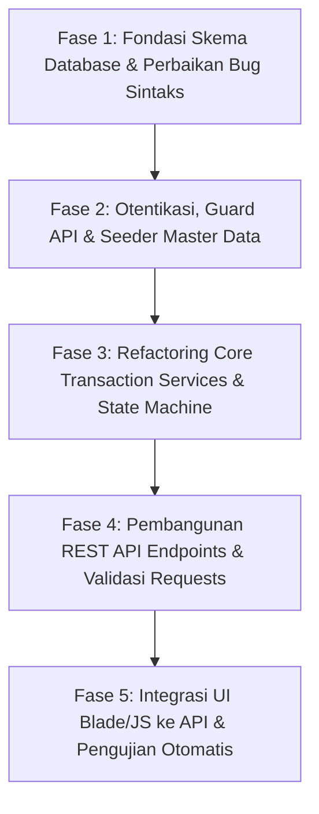

# AUDIT MENYELURUH BACKEND KOPERASIKU
**Dokumen Hasil Audit Kepatuhan PRD, ERD, PIC B, PIC C & Arsitektur Sistem**  
**Tanggal Audit:** 17 November 2026  
**Auditor:** Senior Laravel Backend Engineer, Database Engineer & Software Architect  
**Status:** Menunggu Persetujuan Manajerial / Pemilik Proyek (Tidak Ada Perubahan Kode Dilakukan)

---

## 1. RINGKASAN KONDISI BACKEND

Berdasarkan audit komprehensif terhadap repositori aplikasi **KoperasiKu**, kode backend berada dalam status **fase prototipe awal yang belum terintegrasi (disconnected prototype)**. 

### Kondisi Utama:
1. **Frontend Visual Lengkap Namun Terisolasi:**  
   Antarmuka pengguna (Blade views dan vanilla JavaScript di `resources/views` dan `resources/js`) telah selesai dibangun dengan komponen visual interaktif modern (Keranjang Drawer, Modal Detail Tokopedia-style, Kamera Barcode Scanner, POS Kasir, dan Dashboard Manajer). Namun, **100% logika frontend berjalan secara mock lokal** menggunakan array PHP hardcoded di controller (`LandingController`, `CashierController`, `ManagerController`, `MemberController`) serta manipulasi DOM/`sessionStorage` di JavaScript tanpa pernah memanggil API backend.
2. **Backend Transaksi Baru Berupa Fondasi Parsial:**  
   Terdapat implementasi awal logika transaksi pada `TransactionService` dan migrasi awal tabel transaksi inti (`orders`, `order_items`, `inventory_balances`, `stock_reservations`, `credit_policies`, `receivables`, dll.). Namun, banyak aturan bisnis kritis yang terlewat atau tidak konsisten (misalnya ketiadaan verifikasi pembayaran pada pickup tunai/transfer, metode pembatalan yang belum tersambung ke controller, dan inkonsistensi penamaan kolom).
3. **Autentikasi & Autorisasi API Rusak:**  
   Rute API (`routes/api.php`) dikonfigurasi menggunakan middleware `auth:sanctum`, namun paket `laravel/sanctum` **belum terpasang di `composer.json`** dan belum terdaftar di `config/auth.php`. Akibatnya, setiap pemanggilan rute API akan langsung menghasilkan error `InvalidArgumentException: Auth guard [sanctum] is not defined`. Rute web kasir dan manajer juga tidak memiliki proteksi middleware auth/role sama sekali.
4. **Master Data & Skema Database Belum Lengkap:**  
   Tabel-tabel fundamental milik PIC C (Master Data) seperti `members`, `categories`, `products`, `suppliers`, `purchase_receipts`, `product_price_histories`, `operating_expenses`, dan tabel impor staging **belum memiliki file migrasi sama sekali**. Model `TransactionService` bahkan melakukan query `DB::table('products')` yang akan langsung gagal jika dijalankan pada database nyata karena tabel tersebut belum ada.
5. **Ketiadaan Pengujian Domain Otomatis:**  
   Seluruh 10 skenario pengujian wajib PIC B (`B-T01` s/d `B-T10`) dan 9 skenario PIC C (`C-T01` s/d `C-T09`) belum diimplementasikan. Repositori hanya memuat file `ExampleTest` bawaan Laravel.

---

## 2. ARSITEKTUR PROYEK SAAT INI

### 2.1 Diagram Struktur Arsitektur Aktual

```text
KoperasiKu-repo/
├── app/
│   ├── Enum/                   [KOSONG - belum ada enum OrderStatus, PaymentStatus, dll]
│   ├── Http/
│   │   ├── Controllers/
│   │   │   ├── CashierController.php    [Web Controller: Return View dengan Mock Data PHP]
│   │   │   ├── LandingController.php    [Web Controller: Return View dengan Mock Data PHP]
│   │   │   ├── ManagerController.php    [Web Controller: Return View dengan Mock Data PHP]
│   │   │   ├── MemberController.php     [Web Controller: Return View dengan Mock Data PHP]
│   │   │   ├── OrderController.php      [API Controller: Checkout & Confirm Pickup]
│   │   │   ├── POSController.php        [API Controller: POS Sale]
│   │   │   └── ReceivableController.php [API Controller: Pay Receivable]
│   │   ├── Middleware/
│   │   │   └── CheckRole.php            [RBAC Middleware: Memeriksa role pengguna]
│   │   ├── Requests/           [TIDAK ADA - Validasi hanya inline di controller]
│   │   └── Policies/           [TIDAK ADA - Belum ada Policy otorisasi domain]
│   ├── Models/                 [12 Model Eloquent: Sebagian besar UUID tapi tidak konsisten]
│   └── Services/
│       ├── ApiClient.php                [Skeleton kosong tanpa implementasi HTTP client]
│       ├── CreditEligibilityService.php [Logika kelayakan kredit - query kolom tidak cocok]
│       ├── InventoryService.php         [Error sintaks: tanpa tag <?php, kolom tidak cocok]
│       ├── ReceivablePaymentService.php [Logika cicilan - duplikasi dengan TransactionService]
│       └── TransactionService.php       [God Service transaksi: checkout, pickup, pos, cicilan]
├── database/
│   ├── migrations/             [Hanya 4 file: users, cache, jobs, core_transactions]
│   └── seeders/                [DatabaseSeeder gagal; TransactionTestSeeder mengabaikan products]
├── resources/
│   ├── js/
│   │   └── landing.js          [Client-side mock checkout: generate PKP-XXXXX di browser]
│   └── views/
│       ├── cashier/pos.blade.php        [Client-side mock POS & Pickup Handover]
│       ├── cashier/piutang.blade.php    [Client-side mock Pelunasan Piutang]
│       ├── manager/kredit.blade.php     [Client-side mock Policy Alert]
│       └── ...
└── routes/
    ├── api.php                 [Prefix /v1: Terkunci di auth:sanctum yang belum terinstall]
    └── web.php                 [Mock auth via session, tanpa middleware pada cashier/manager]
```

### 2.2 Evaluasi Arsitektur
- **Pola Desain:** Arsitektur mengarah pada *Service-Oriented Controller* (Controller memanggil Service). Namun, seluruh beban domain transaksi ditumpuk di satu kelas `TransactionService.php` (God Class) alih-alih dipecah menjadi *Single Responsibility Services* seperti panduan PIC B (`CheckoutService`, `PickupService`, `PosSaleService`, `PaymentService`, dll.).
- **Dualitas Service yang Membingungkan:** Terdapat `InventoryService` dan `ReceivablePaymentService` yang berdiri sendiri, namun logika di dalamnya diimplementasikan ulang (didukplikasi) di dalam `TransactionService.php` dengan perbedaan nama kolom dan struktur pemanggilan.

---

## 3. DAFTAR FITUR YANG SUDAH BENAR

Meskipun masih terisolasi, terdapat konsep dan logika fondasi yang sudah sesuai dengan PRD dan ERD:

1. **Prinsip Tiga Role RBAC:** Sistem secara konsisten mendefinisikan tepat tiga role: `MEMBER`, `CASHIER`, `MANAGER`. Tidak ada role `ADMIN`. Skema migrasi `user_roles` mendukung multi-role per akun pengguna.
2. **Konsep Reservasi Stok Saat Checkout:** Logika `checkout()` pada `TransactionService` menaikkan nilai `reserved` pada tabel `inventory_balances` dan mencatat data ke `stock_reservations`, tanpa mengurangi `on_hand`.
3. **Pengurangan Stok Fisik Saat Pickup / POS:** Logika pemotongan `on_hand` dan pelepasan `reserved` baru dieksekusi saat konfirmasi pickup atau penjualan langsung di kasir (POS).
4. **Kebijakan Kredit Global Tunggal:** Baik dokumen seeder, model, maupun logika validasi kredit telah mengadopsi prinsip batas pagu kredit tunggal (*global credit limit*), bukan limit individual per anggota.
5. **Jatuh Tempo 7 Hari Kalender:** Perhitungan tanggal jatuh tempo piutang konsisten menggunakan penambahan tepat 7 hari kalender (`Carbon::now('Asia/Jakarta')->addDays(7)->toDateString()`).
6. **Perhitungan Sisa Limit Komprehensif:** Pengecekan limit kredit di `TransactionService` dan `CreditEligibilityService` memperhitungkan agregat `outstanding_amount` (faktur aktif) ditambah `active_holds` (pesanan kredit yang belum diambil).
7. **Aturan POS Non-Anggota Wajib Lunas:** Transaksi POS kasir menolak metode `CREDIT` apabila `member_id` kosong (`null`).
8. **UI/UX Prototipe yang Sangat Representatif:** Desain antarmuka Blade untuk katalog sembako, drawer keranjang belanja, kasir POS dengan barcode scanner kamera HP/webcam, manajemen antrean pickup, serta dashboard penuaan (*aging*) piutang 5 kelompok telah sesuai dengan seluruh kebutuhan PRD v1.4.

---

## 4. DAFTAR FITUR YANG BELUM TERSEDIA

Fitur-fitur berikut diwajibkan oleh PRD, ERD, dan Jobdesk PIC B/C namun **belum diimplementasikan**:

1. **Autentikasi API Riil & Pengelolaan Token:**  
   Belum ada endpoint `POST /api/v1/auth/login`, `POST /api/v1/auth/logout`, maupun `GET /api/v1/auth/me`.
2. **Koneksi Integrasi Frontend ke Backend (HTTP Fetch / AJAX):**  
   Frontend sama sekali belum melakukan request HTTP asinkron ke endpoint API `/api/v1/*`.
3. **Penerbitan & Validasi Kode Pickup Unik di Backend:**  
   Pesanan online belum menghasilkan `pickup_code` di backend (kolom bahkan belum ada di database).
4. **Pencatatan Pembayaran Pesanan Online (Kasir / Transfer):**  
   Belum ada endpoint untuk mencatat uang muka/pembayaran pesanan pickup tunai/transfer (`POST /api/v1/orders/{id}/payments`).
5. **Verifikasi Pembayaran Transfer Kasir:**  
   Belum ada endpoint `POST /api/v1/payments/{id}/verify` untuk memvalidasi transfer bank sebelum serah terima barang atau sebelum piutang dipotong.
6. **Lookup Barcode & SKU untuk Kasir:**  
   Belum ada endpoint `GET /api/v1/products/lookup?barcode=` untuk menghubungkan pemindai kamera POS dengan database barang.
7. **Antrean Pickup Kasir Terhubung Database:**  
   Belum ada endpoint `GET /api/v1/cashier/orders` untuk menyuplai antrean pesanan siap ambil ke layar kasir.
8. **Portal Informasi Kredit & Piutang Anggota:**  
   Belum ada endpoint `GET /api/v1/members/me/credit` dan `GET /api/v1/members/me/receivables`.
9. **Manajemen Kebijakan Kredit Global oleh Manajer:**  
   Belum ada endpoint `GET /api/v1/credit-policy` dan `PATCH /api/v1/credit-policy` untuk memperbarui limit seragam.
10. **Aktivasi & Pemblokiran Fasilitas Kredit Anggota:**  
    Belum ada endpoint `PATCH /api/v1/members/{id}/credit-status`.
11. **Seluruh Modul Master Data PIC C:**  
    - CRUD Kategori, Produk, Satuan, dan Pemasok.
    - Riwayat Perubahan Harga Jual (`product_price_histories`).
    - Penerimaan Stok dari Pemasok (`purchase_receipts` & `receipt_items`) dengan perhitungan HPP Moving Weighted Average.
    - Pencatatan Biaya Operasional Gerai (`operating_expenses`).
    - Modul Impor Excel/CSV Idempotent (Upload, Staging Rows, Error Report, Preview, Commit).
12. **Idempotency & Audit Trail:**  
    Tabel dan mekanisme pencegahan eksekusi ganda (`idempotency_records`) dan log audit mutasi (`audit_logs`) belum dibuat.

---

## 5. DAFTAR BUG DAN KETIDAKSESUAIAN

### 5.1 [CRITICAL] Sintaks PHP Rusak pada InventoryService
- **Lokasi File:** `app/Services/InventoryService.php` (Baris 1)
- **Alasan:** File diawali langsung dengan teks `namespace App\Services;` tanpa tag pembuka `<?php`.
- **Dampak:** File tidak dapat di-*compile* oleh engine PHP, langsung melempar *Parse Error / Fatal Error* saat kelas dimuat, dan mencemari output HTTP jika di-*include*.
- **Rekomendasi:** Tambahkan tag `<?php` pada baris pertama file.

### 5.2 [CRITICAL] Konfirmasi Pickup Menyerahkan Barang Tanpa Verifikasi Pembayaran
- **Lokasi File:** `app/Services/TransactionService.php` (`confirmPickup`, Baris 112–173)
- **Alasan:** Metode `confirmPickup()` hanya memeriksa apakah order berstatus `COMPLETED`. Untuk pesanan dengan metode `CASH` atau `BANK_TRANSFER`, service **sama sekali tidak memeriksa** apakah pembayaran sudah dilakukan dan berstatus `VERIFIED`.
- **Dampak:** Kasir dapat menyelesaikan pesanan dan menyerahkan barang fisik tanpa anggota membayar sepeser pun. Tidak ada pencatatan kas/uang masuk di tabel `payments`.
- **Rekomendasi:** Tambahkan validasi ketat: jika `payment_choice` adalah `CASH` atau `BANK_TRANSFER`, wajib memverifikasi keberadaan record `payments` dengan status `VERIFIED` sebelum stok dikurangi dan order ditandai `COMPLETED`.

### 5.3 [CRITICAL] Route Cancel Memanggil Method yang Tidak Ada di Controller
- **Lokasi File:** `routes/api.php` (Baris 15) dan `app/Http/Controllers/OrderController.php`
- **Alasan:** Rute `POST /api/v1/orders/{id}/cancel` didefinisikan memanggil `[OrderController::class, 'cancel']`. Namun di dalam kelas `OrderController.php`, method `cancel()` **tidak ada**. Logika pembatalan hanya ada di dalam `TransactionService::cancelOrder()`.
- **Dampak:** Memanggil endpoint pembatalan pesanan akan langsung memicu `BadMethodCallException: Method App\Http\Controllers\OrderController::cancel does not exist`.
- **Rekomendasi:** Buat method `cancel(string $id)` pada `OrderController.php` yang memanggil `TransactionService::cancelOrder($id)`.

### 5.4 [CRITICAL] Sanctum Guard Belum Dikonfigurasi
- **Lokasi File:** `routes/api.php` (Baris 11, 19), `composer.json`, `config/auth.php`
- **Alasan:** Rute API dibungkus middleware `auth:sanctum`, namun dependensi `laravel/sanctum` tidak ada di `composer.json` dan guard `sanctum` tidak terdaftar di `config/auth.php`.
- **Dampak:** Seluruh request ke API v1 gagal dengan pesan error internal 500 (`Auth guard [sanctum] is not defined`).
- **Rekomendasi:** Pasang dependensi Sanctum atau gunakan session/token guard yang sah sesuai spesifikasi arsitektur tim.

### 5.5 [HIGH] Inkonsistensi Nama Kolom pada StockMovement
- **Lokasi File:**  
  - Migrasi: `database/migrations/2026_11_16_073353_create_core_transaction_tables.php` (Baris 82–85)
  - `app/Services/InventoryService.php` (Baris 63–67)
  - `app/Services/TransactionService.php` (Baris 130–133)
- **Alasan:**  
  - ERD & `InventoryService` menggunakan: `qty_delta`, `movement_type`, `source_ref`, `occurred_at`.
  - Migrasi & `TransactionService` menggunakan: `quantity_change`, `type`, `reference_id`, `reason`.
- **Dampak:** `InventoryService::fulfillStock()` akan melempar SQL exception (`column "qty_delta" does not exist`) saat dijalankan.
- **Rekomendasi:** Standarkan seluruh definisi kolom `stock_movements` mengikuti ERD v1.4 (`qty_delta`, `movement_type`, `source_ref`, `occurred_at`).

### 5.6 [HIGH] Kolom Status pada StockReservation Hilang dari Migrasi
- **Lokasi File:** `database/migrations/2026_11_16_073353_create_core_transaction_tables.php` (Baris 69–77) vs `app/Services/InventoryService.php` (Baris 35, 48, 71, 95)
- **Alasan:** Tabel `stock_reservations` di migrasi hanya memiliki `id`, `order_id`, `product_id`, `quantity`, `timestamps`. Kolom `status` (ACTIVE, FULFILLED, CANCELLED) yang diwajibkan ERD tidak dibuat.
- **Dampak:** `InventoryService` yang melakukan filter `where('status', 'ACTIVE')` dan update status akan langsung gagal dengan *QueryException*.
- **Rekomendasi:** Tambahkan kolom `status` bertipe string default `'ACTIVE'` pada migrasi `stock_reservations`.

### 5.7 [HIGH] Kolom is_active vs active pada CreditPolicy
- **Lokasi File:** Migrasi `credit_policies` (Baris 15) vs `app/Services/CreditEligibilityService.php` (Baris 34)
- **Alasan:** Migrasi menamai kolom `active`, sedangkan ERD dan `CreditEligibilityService` memanggil `where('is_active', true)`.
- **Dampak:** `CreditEligibilityService::checkEligibility()` melempar SQL error `column "is_active" does not exist` sehingga selalu mengembalikan status gagal kredit.
- **Rekomendasi:** Ubah nama kolom pada skema `credit_policies` menjadi `is_active` sesuai ERD.

### 5.8 [HIGH] Kolom verified_at Hilang pada Tabel Payments
- **Lokasi File:** Migrasi `payments` (Baris 103–112) vs `app/Services/ReceivablePaymentService.php` (Baris 32)
- **Alasan:** Migrasi hanya memiliki kolom `verified_by`, tanpa kolom `verified_at`. Padahal ERD dan `ReceivablePaymentService` mencatat waktu verifikasi kasir.
- **Dampak:** Eksekusi pelunasan piutang via `ReceivablePaymentService` akan gagal saat menyimpan waktu verifikasi.
- **Rekomendasi:** Tambahkan kolom `$table->timestamp('verified_at')->nullable();` pada tabel `payments`.

### 5.9 [MEDIUM] User Model & DatabaseSeeder Tidak Sesuai Skema
- **Lokasi File:** `app/Models/User.php` dan `database/factories/UserFactory.php` vs `0001_01_01_000000_create_users_table.php`
- **Alasan:** Migrasi `users` mendefinisikan kolom: `id` (UUID), `email`, `password_hash`, `status`. Namun `User.php` dan `UserFactory.php` masih menggunakan atribut standar Laravel (`name`, `password`).
- **Dampak:** Menjalankan seeder bawaan atau autentikasi standar Eloquent akan memicu crash database karena kolom `name` dan `password` tidak ada.
- **Rekomendasi:** Sesuaikan `User.php` agar menggunakan `HasUuids`, mendefinisikan `getAuthPasswordName()` yang merujuk ke `password_hash`, serta memetakan relasi `roles()` dan `member()`.

### 5.10 [MEDIUM] UniqueId Generator Mengganggu Foreign Key pada InventoryBalance & MemberCreditAccount
- **Lokasi File:** `app/Models/InventoryBalance.php` (Baris 18–21) dan `app/Models/MemberCreditAccount.php` (Baris 18–21)
- **Alasan:** Kedua model menggunakan trait `HasUuids` dan mendeklarasikan `uniqueIds() { return ['product_id']; }` dan `uniqueIds() { return ['member_id']; }`. Padahal `product_id` dan `member_id` adalah *Foreign Key* yang berasal dari entitas induk (`products` dan `members`), bukan UUID acak baru yang di-generate sendiri oleh Eloquent.
- **Dampak:** Berisiko menimpa nilai ID relasi yang valid dengan UUID baru yang tidak terhubung ke master data.
- **Rekomendasi:** Hapus method `uniqueIds()` otomatis pada model yang primary key-nya merupakan foreign key murni; tentukan primary key secara manual saat insert.

### 5.11 [MEDIUM] Potensi Deadlock Database pada Concurrency Multi-Item
- **Lokasi File:** `app/Services/TransactionService.php` (`checkout`, Baris 30–35; `posSale`, Baris 191–196)
- **Alasan:** Penguncian baris (`lockForUpdate()`) pada tabel `inventory_balances` dilakukan berurutan berdasarkan array item yang dikirim oleh client.
- **Dampak:** Jika User A memesan [Produk 1, Produk 2] secara bersamaan dengan User B yang memesan [Produk 2, Produk 1], PostgreSQL akan mengalami *Deadlock*, menyebabkan salah satu transaksi gagal dibatalkan sistem (*abort*).
- **Rekomendasi:** Urutkan ID produk secara konsisten (misalnya urut alfabet/UUID `product_id ASC`) sebelum melakukan `lockForUpdate()`.

---

## 6. KETIDAKSESUAIAN DATABASE DAN ERD

Berikut perbandingan matriks antara **ERD Database KOPERADATA v1.4** dengan skema migrasi aktual:

| Tabel ERD v1.4 | Status Migrasi | Temuan Ketidaksesuaian / Detail Hilang |
|---|:---:|---|
| `users` | Tersedia | Kolom `status` dan `password_hash` ada, tetapi relasi ke roles di model belum dibuat. |
| `roles` | Tersedia | Skema ada, tetapi seeder untuk `MEMBER`, `CASHIER`, `MANAGER` belum dibuat. |
| `user_roles` | Tersedia | Skema pivot ada (`user_id`, `role_code`). |
| `members` | **TIDAK ADA** | **Tabel sama sekali belum ada.** Atribut seperti `employee_number UK`, `member_number UK`, `full_name`, `department`, `status` belum memiliki skema. |
| `categories` | **TIDAK ADA** | **Tabel belum ada.** Kategori barang sembako belum dapat disimpan secara relasional. |
| `products` | **TIDAK ADA** | **Tabel belum ada.** Kolom `sku UK`, `barcode UK`, `selling_price`, `current_cost`, `reorder_point`, `is_active` belum ada. `TransactionService` melempar fatal error saat query tabel ini. |
| `product_price_histories`| **TIDAK ADA** | **Tabel belum ada.** Log perubahan harga jual dan HPP acuan oleh Manajer belum ada. |
| `suppliers` | **TIDAK ADA** | **Tabel belum ada.** Data mitra pemasok dan `lead_time_days` belum ada. |
| `purchase_receipts` | **TIDAK ADA** | **Tabel belum ada.** Penerimaan barang dan pencatatan HPP masuk belum ada. |
| `receipt_items` | **TIDAK ADA** | **Tabel belum ada.** Rincian item faktur penerimaan supplier belum ada. |
| `operating_expenses` | **TIDAK ADA** | **Tabel belum ada.** Beban operasional toko (listrik, ATK, pemeliharaan) belum ada. |
| `import_batches` | **TIDAK ADA** | **Tabel belum ada.** Pelacakan checksum dan status batch impor Excel belum ada. |
| `import_rows` | **TIDAK ADA** | **Tabel belum ada.** Staging baris Excel historis belum ada. |
| `import_errors` | **TIDAK ADA** | **Tabel belum ada.** Log penolakan baris impor Excel belum ada. |
| `audit_logs` | **TIDAK ADA** | **Tabel belum ada.** Audit trail aktivitas kritis aktor/pengguna belum ada. |
| `credit_policy_logs` | **TIDAK ADA** | **Tabel belum ada.** Riwayat penetapan pagu limit kredit oleh manajer belum tercatat. |
| `idempotency_records` | **TIDAK ADA** | **Tabel belum ada.** Kunci idempotensi operasi domain belum disimpan di database. |
| `orders` | Tersedia Parsial | **Kolom `pickup_code UK` belum ada.** Foreign key ke `members` belum didefinisikan. |
| `order_items` | Tersedia Parsial | Foreign key ke `products` belum ada. On delete cascade pada orders membahayakan integritas data historis. |
| `inventory_balances` | Tersedia Parsial | Check constraint `on_hand >= reserved >= 0` belum dipasang di level DDL PostgreSQL. |
| `stock_reservations` | Tersedia Parsial | **Kolom `status` (ACTIVE/FULFILLED/CANCELLED) belum ada.** |
| `stock_movements` | Tersedia Parsial | Nama kolom tidak sesuai ERD (`quantity_change` vs `qty_delta`, `type` vs `movement_type`). |
| `credit_policies` | Tersedia Parsial | Nama kolom `active` seharusnya `is_active`. Check constraint `due_days = 7` dan `limit_amount >= 0` belum ada. Partial unique index satu record aktif belum ada. |
| `member_credit_accounts` | Tersedia Parsial | Foreign key ke `members` belum ada. |
| `credit_holds` | Tersedia | Kolom inti sesuai ERD (`order_id UK`, `member_id`, `amount`, `status`). |
| `receivables` | Tersedia Parsial | Menggunakan kolom `status` string (berpotensi *stale* alih-alih derived). Menggunakan `onDelete('cascade')` yang dilarang PRD. |
| `payments` | Tersedia Parsial | **Kolom `verified_at` belum ada.** Kolom `external_reference` (bukti transfer) belum ada. |
| `receivable_payment_allocations`| Tersedia | Skema pivot alokasi pembayaran piutang ada, namun relasi cascade delete dari payments berisiko menghapus jejak audit. |

---

## 7. KETIDAKSESUAIAN API DENGAN KEBUTUHAN FRONTEND

Terdapat ketidaksinkronan mutlak antara kebutuhan data antarmuka pengguna (UI) dengan ketersediaan API:

### 7.1 Etalase Storefront & Checkout Anggota
- **Kebutuhan Frontend (`landing.blade.php`, `landing.js`):**
  - Mengambil daftar produk aktif beserta foto, kategori, stok tersedia kasir (`available`), dan harga jual.
  - Mengirim pesanan online pickup dengan payload item dan metode pembayaran (`CASH`, `BANK_TRANSFER`, `CREDIT`).
  - Menerima respon sukses berupa `pickup_code` resmi dari backend untuk ditampilkan di tiket modal.
- **Kondisi Backend Aktual:**
  - Tidak ada endpoint katalog produk publik (`GET /api/v1/products`).
  - Endpoint `POST /api/v1/orders` tidak mengembalikan `pickup_code`.
  - Frontend mengakali ini dengan membuat kode acak di browser (`PKP-` + random) dan menghapus isi keranjang di `sessionStorage` tanpa pernah mengirim data ke server.

### 7.2 Layar POS Kasir & Pemindai Barcode
- **Kebutuhan Frontend (`cashier/pos.blade.php`):**
  - Pemindaian barcode kamera memerlukan respon cepat untuk menerjemahkan barcode `89999991001` menjadi SKU, nama barang, harga jual, dan sisa stok.
  - Tombol "Selesaikan Transaksi & Cetak Struk" memerlukan penyimpanan pesanan kasir langsung dan pencatatan pembayaran tunai/transfer/kredit.
- **Kondisi Backend Aktual:**
  - Endpoint `GET /api/v1/products/lookup?barcode=` tidak ada.
  - Endpoint `POST /api/v1/pos/sale` ada di backend, tetapi JavaScript kasir tidak pernah memanggilnya; kasir hanya menampilkan modal HTML lokal dan me-reset keranjang.

### 7.3 Verifikasi Antrean Pickup Kasir
- **Kebutuhan Frontend (`cashier/pos.blade.php` Tab Antrean):**
  - Menampilkan daftar pesanan berstatus `PENDING_PICKUP` atau `READY_FOR_PICKUP`.
  - Kasir mencocokkan kode pickup anggota, memeriksa status pembayaran lunas, lalu menekan tombol "Serahkan Barang".
- **Kondisi Backend Aktual:**
  - Endpoint `GET /api/v1/cashier/orders` tidak ada. Kasir menampilkan array PHP statis.
  - Tombol "Serahkan Barang" hanya mengubah teks badge di layar browser melalui JavaScript DOM tanpa memanggil `POST /api/v1/orders/{id}/confirm-pickup`.

### 7.4 Pelunasan & Pembayaran Cicilan Piutang Kasir
- **Kebutuhan Frontend (`cashier/piutang.blade.php`):**
  - Kasir memilih anggota untuk memuat pagu kredit global, sisa limit, status tunggakan, dan daftar faktur piutang yang belum lunas.
  - Kasir menginput nominal pembayaran dan strategi alokasi (otomatis FIFO atau manual per faktur).
- **Kondisi Backend Aktual:**
  - Endpoint `GET /api/v1/cashier/receivables?member_id=` tidak ada.
  - Endpoint `POST /api/v1/receivables/payments` ada di backend, tetapi script kasir hanya menampilkan modal struk pembayaran simulasi di browser.

### 7.5 Portal Manajer (Kredit, Produk, Impor, Analitik)
- **Kebutuhan Frontend (`manager/*.blade.php`):**
  - Form limit kredit global manajer memerlukan penyimpanan audit log perubahan pagu.
  - Tombol blokir/aktifkan anggota memerlukan update status fasilitas piutang.
  - Pengubahan harga jual memerlukan pencatatan alasan dan actor.
- **Kondisi Backend Aktual:**
  - Endpoint `GET/PATCH /api/v1/credit-policy` tidak ada.
  - Endpoint `PATCH /api/v1/members/{id}/credit-status` tidak ada.
  - Endpoint `PATCH /api/v1/products/{id}/pricing` tidak ada.
  - Seluruh tombol manajer hanya memicu pop-up `alert()` browser.

---

## 8. RISIKO KEAMANAN DAN TRANSAKSI

1. **Akses Terbuka Tanpa Autentikasi pada Portal Manajer & Kasir (Bypass Authorization):**  
   Rute web `/cashier/*` dan `/manager/*` tidak dilindungi oleh middleware auth maupun role. Siapa pun yang mengetahui URL dapat langsung membuka dashboard analitik manajer, data piutang, dan POS kasir.
2. **Manipulasi Role Konteks (Insecure Role Switching):**  
   Rute `POST /mock-switch-role` pada `routes/web.php` menerima input string `role` dari form tanpa memvalidasi apakah user yang sedang login benar-benar memiliki hak akses role tersebut di tabel `user_roles`.
3. **Pemberian Barang Tanpa Uang (Financial Loss on Pickup):**  
   Karena method `confirmPickup()` tidak mengecek status pembayaran `VERIFIED` untuk order non-kredit, barang dapat diserahkan tanpa uang masuk tercatat di kas koperasi.
4. **Kehilangan Jejak Audit Akibat Cascade Delete:**  
   Relasi foreign key `onDelete('cascade')` pada tabel `orders` -> `order_items`, `orders` -> `receivables`, dan `payments` -> `receivable_payment_allocations` sangat berbahaya. Jika sebuah baris pesanan dihapus, seluruh tagihan piutang dan alokasi pembayaran akan terhapus permanen dari basis data.
5. **Kebocoran Informasi HPP (Data Privacy Breach):**  
   Data mock di `CashierController.php` membocorkan nilai `cost_price` (HPP) ke tampilan kasir. PRD Bagian 5 dan PIC C secara tegas menetapkan bahwa Anggota dan Kasir dilarang melihat HPP/current_cost produk; HPP hanya boleh dilihat oleh Manajer.
6. **Race Condition Melebihi Batas Kredit Global:**  
   Pengecekan kelayakan kredit di `CreditEligibilityService` tidak melakukan penguncian pesimistik pada baris akun kredit atau tabel terkait sebelum menghitung agregat outstanding. Dua checkout kredit simultan dari anggota yang sama dapat sama-sama lolos validasi limit.
7. **Ketiadaan CSRF / Rate Limiting pada API:**  
   Rute API tidak dilengkapi throttling/rate limiting untuk mencegah brute-force login, spam checkout, atau serangan denial-of-service pada transaksi inventaris.

---

## 9. DAFTAR MIGRATION YANG DIBUTUHKAN

Untuk menyelaraskan struktur database dengan ERD v1.4 dan PRD KoperasiKu tanpa merusak data lama, migrasi bertahap berikut wajib dibuat:

### 9.1 Migrasi Baru (Tabel Belum Ada)
1. `create_members_table`:
   - Kolom: `id (UUID PK)`, `user_id (UUID FK ke users, nullable/unique)`, `employee_number (string UK)`, `member_number (string UK)`, `full_name (string)`, `department (string)`, `status (string: ACTIVE/INACTIVE)`, `timestamps`.
2. `create_categories_table`:
   - Kolom: `id (UUID PK)`, `name (string)`, `icon (string nullable)`, `timestamps`.
3. `create_products_table`:
   - Kolom: `id (UUID PK)`, `category_id (UUID FK ke categories)`, `sku (string UK)`, `barcode (string UK nullable)`, `name (string)`, `unit (string)`, `selling_price (numeric 18,2)`, `current_cost (numeric 18,2)`, `reorder_point (integer default 10)`, `is_active (boolean default true)`, `timestamps`.
4. `create_product_price_histories_table`:
   - Kolom: `id (UUID PK)`, `product_id (UUID FK ke products)`, `old_cost (numeric 18,2)`, `new_cost (numeric 18,2)`, `old_sell_price (numeric 18,2)`, `new_sell_price (numeric 18,2)`, `reason (text nullable)`, `changed_by (UUID FK ke users)`, `changed_at (timestamp)`.
5. `create_suppliers_table`:
   - Kolom: `id (UUID PK)`, `name (string)`, `lead_time_days (integer default 3)`, `contact_info (text nullable)`, `timestamps`.
6. `create_purchase_receipts_table`:
   - Kolom: `id (UUID PK)`, `supplier_id (UUID FK ke suppliers)`, `received_at (timestamp)`, `status (string)`, `created_by (UUID FK ke users)`, `timestamps`.
7. `create_receipt_items_table`:
   - Kolom: `id (UUID PK)`, `receipt_id (UUID FK ke purchase_receipts)`, `product_id (UUID FK ke products)`, `quantity (integer)`, `unit_cost (numeric 18,2)`, `timestamps`.
8. `create_operating_expenses_table`:
   - Kolom: `id (UUID PK)`, `expense_date (date)`, `amount (numeric 18,2)`, `category (string)`, `reference (string nullable)`, `created_by (UUID FK ke users)`, `timestamps`.
9. `create_excel_import_tables`:
   - `import_batches`: `id (UUID PK)`, `uploaded_by (UUID FK ke users)`, `filename (string)`, `checksum (string)`, `import_type (string)`, `status (string)`, `cutoff_at (timestamp nullable)`, `timestamps`.
   - `import_rows`: `id (UUID PK)`, `batch_id (UUID FK)`, `row_number (integer)`, `row_status (string)`, `source_key (string nullable)`, `payload (jsonb)`, `timestamps`.
   - `import_errors`: `id (UUID PK)`, `import_row_id (UUID FK)`, `field_name (string)`, `error_code (string)`, `error_message (text)`, `timestamps`.
10. `create_idempotency_and_audit_tables`:
    - `idempotency_records`: `id (UUID PK)`, `key (string UK)`, `scope (string)`, `request_payload (jsonb nullable)`, `response_payload (jsonb nullable)`, `status_code (integer)`, `created_at (timestamp)`.
    - `audit_logs`: `id (UUID PK)`, `actor_user_id (UUID FK ke users nullable)`, `action (string)`, `entity_type (string)`, `entity_id (string)`, `details (jsonb nullable)`, `occurred_at (timestamp)`.
    - `credit_policy_logs`: `id (UUID PK)`, `policy_id (UUID FK)`, `old_limit (numeric 18,2)`, `new_limit (numeric 18,2)`, `reason (text)`, `changed_by (UUID FK ke users)`, `changed_at (timestamp)`.

### 9.2 Migrasi Penyesuaian (Alter Table Tabel Eksisting)
1. `alter_orders_add_pickup_code`:
   - Menambahkan kolom `pickup_code` bertipe `string` unik (`nullable`), index pada `pickup_code`.
   - Menambahkan foreign key `member_id` merujuk ke tabel `members(id)` dengan `onDelete('restrict')`.
2. `alter_order_items_fix_foreign_and_constraints`:
   - Menambahkan foreign key `product_id` merujuk ke `products(id)` dengan `onDelete('restrict')`.
   - Mengubah relasi `order_id` dari cascade delete menjadi restrict.
3. `alter_stock_reservations_add_status`:
   - Menambahkan kolom `status` bertipe `string` default `'ACTIVE'`.
   - Menambahkan foreign key `product_id` merujuk ke `products(id)`.
4. `alter_stock_movements_align_erd`:
   - Mengubah kolom `quantity_change` menjadi `qty_delta`.
   - Mengubah kolom `type` menjadi `movement_type`.
   - Mengubah kolom `reference_id` menjadi `source_ref`.
   - Menambahkan kolom `occurred_at` bertipe `timestamp` default `now()`.
5. `alter_credit_policies_align_erd`:
   - Mengubah kolom `active` menjadi `is_active`.
   - Menambahkan constraint CHECK: `CHECK (limit_amount >= 0)`.
   - Menambahkan constraint CHECK: `CHECK (due_days = 7)`.
6. `alter_payments_add_verified_at_and_ref`:
   - Menambahkan kolom `verified_at` bertipe `timestamp nullable`.
   - Menambahkan kolom `external_reference` bertipe `string nullable` (nomor mutasi/QRIS).
   - Menambahkan kolom `idempotency_key` bertipe `string nullable`.
7. `alter_inventory_balances_add_check_constraints`:
   - Menambahkan foreign key `product_id` merujuk ke `products(id)` dengan `onDelete('restrict')`.
   - Menambahkan constraint CHECK: `CHECK (on_hand >= 0 AND reserved >= 0 AND reserved <= on_hand)`.

---

## 10. DAFTAR ENDPOINT API YANG BELUM TERSEDIA

Berikut daftar lengkap seluruh endpoint API `/api/v1` yang wajib disediakan untuk melayani frontend dan integrasi sistem:

### 10.1 Autentikasi & Pengguna (PIC B)
- `POST /api/v1/auth/login` — Autentikasi kredensial pengguna, mengembalikan bearer token & daftar role.
- `POST /api/v1/auth/logout` — Revoke token aktif.
- `GET /api/v1/auth/me` — Profil user aktif, role aktif, dan data member tertaut.

### 10.2 Pemesanan & Pickup (PIC B)
- `GET /api/v1/orders/my` — Daftar riwayat pesanan milik anggota yang sedang login.
- `GET /api/v1/orders/{id}` — Detail rincian pesanan dan status kesiapan pickup.
- `GET /api/v1/cashier/orders` — Antrean pesanan siap pickup untuk layar kasir gerai.
- `POST /api/v1/orders/{id}/payments` — Kasir mencatat pembayaran tunai/transfer pesanan sebelum serah terima.
- `POST /api/v1/payments/{id}/verify` — Kasir/Manajer memverifikasi bukti transfer pembayaran.

### 10.3 POS Kasir & Barcode (PIC B & C)
- `GET /api/v1/products/lookup?barcode=` — Resolusi barcode scanner ke data produk, harga jual, dan stok gerai.

### 10.4 Kredit, Limit Global & Piutang (PIC B)
- `GET /api/v1/members/me/credit` — Menampilkan plafon global, saldo terpakai, dan sisa limit anggota login.
- `GET /api/v1/members/me/receivables` — Menampilkan daftar faktur piutang berjalan milik anggota login.
- `GET /api/v1/cashier/receivables?member_id=` — Menampilkan profil piutang dan tagihan anggota saat pelayanan di kasir.
- `GET /api/v1/credit-policy` — Manajer melihat konfigurasi limit global aktif dan riwayat perubahannya.
- `PATCH /api/v1/credit-policy` — Manajer mengubah nominal limit global seragam (wajib menyertakan alasan).
- `PATCH /api/v1/members/{id}/credit-status` — Manajer mengaktifkan atau memblokir fasilitas kredit anggota.

### 10.5 Master Data & Inventaris Pemasok (PIC C)
- `GET /api/v1/products` — Katalog produk publik untuk etalase storefront.
- `GET /api/v1/products/{id}` — Spesifikasi detail komoditas sembako.
- `POST /api/v1/products` — Manajer menambahkan produk baru.
- `PUT /api/v1/products/{id}` — Manajer mengubah informasi produk.
- `PATCH /api/v1/products/{id}/pricing` — Manajer mengubah harga jual (tercatat ke history).
- `GET /api/v1/products/{id}/price-history` — Manajer melihat riwayat pergerakan harga jual.
- `GET /api/v1/categories` — Daftar kategori produk.
- `GET/POST /api/v1/suppliers` — Master pemasok dan lead time.
- `POST /api/v1/inventory/receipts` — Penerimaan stok dari pemasok (menghitung HPP rata-rata bergerak).

### 10.6 Biaya Operasional & Impor Excel (PIC C)
- `GET/POST /api/v1/operating-expenses` — Pencatatan biaya operasional (listrik, ATK, pemeliharaan).
- `POST /api/v1/imports` — Upload file Excel/CSV master data atau histori penjualan.
- `GET /api/v1/imports/{id}/preview` — Menampilkan preview baris valid, duplikat, dan salah.
- `POST /api/v1/imports/{id}/commit` — Eksekusi commit data impor secara idempotent.
- `GET /api/v1/imports/{id}/errors` — Unduh daftar baris error validasi impor.

---

## 11. RENCANA PERBAIKAN BERTAHAP

Untuk mengamankan implementasi tanpa merusak kode yang sudah ada, perbaikan dibagi ke dalam 5 fase terukur:



### Fase 1: Fondasi Skema Database & Perbaikan Bug Sintaks
1. Perbaiki tag pembuka `<?php` pada `app/Services/InventoryService.php`.
2. Buat file-file migrasi tabel master PIC C (`members`, `categories`, `products`, `suppliers`, `purchase_receipts`, dll.).
3. Buat migrasi alter table untuk tabel PIC B (`pickup_code`, `status` reservasi, perbaikan nama kolom ledger stok, `is_active`, constraint cek).
4. Buat tabel `idempotency_records`, `audit_logs`, dan `credit_policy_logs`.

### Fase 2: Otentikasi, Guard API & Seeder Master Data
1. Putuskan strategi otentikasi API (Pasang `laravel/sanctum` atau gunakan stateful session token yang konsisten dengan web).
2. Perbarui model `User.php` agar kompatibel dengan UUID, password hash, dan relasi `roles()`.
3. Pasang middleware otentikasi dan pengecekan role yang sebenarnya pada route web kasir (`role:CASHIER,MANAGER`) dan manajer (`role:MANAGER`).
4. Buat `MasterDataSeeder` untuk mengisi 3 roles standar, akun uji coba masing-masing role, kategori sembako, dan produk sembako riil yang ada pada etalase landing page.

### Fase 3: Refactoring Core Transaction Services & State Machine
1. Standarkan seluruh interaksi inventaris dan piutang melalui `InventoryService` dan `CreditEligibilityService`.
2. Perbaiki `TransactionService::confirmPickup()` agar memverifikasi pembayaran `VERIFIED` atau kelayakan kredit sebelum menyerahkan barang dan melepas reservasi.
3. Sambungkan `cancelOrder()` ke controller pembatalan pesanan.
4. Terapkan pengurutan ID produk konsisten sebelum `lockForUpdate()` untuk mencegah *Deadlock*.

### Fase 4: Pembangunan REST API Endpoints & Validasi Requests
1. Buat controller API baru di `app/Http/Controllers/Api/V1/` dengan FormRequest terpisah.
2. Sediakan endpoint lookup barcode, verifikasi pembayaran, antrean pickup kasir, dan penyesuaian limit global manajer.
3. Terapkan mekanisme pengecekan `idempotency_key` pada endpoint checkout, pickup, dan pembayaran cicilan.

### Fase 5: Integrasi UI Blade/JS ke API & Pengujian Otomatis
1. Lengkapi `ApiClient.php` atau buat modul fetch JavaScript (`resources/js/api.js`) untuk memanggil API backend.
2. Sambungkan form checkout di `landing.js` agar memanggil `POST /api/v1/orders` dan menerima `pickup_code` riil.
3. Sambungkan tombol POS kasir dan tombol serah terima pickup agar memanggil endpoint API terkait.
4. Implementasikan 10 Unit & Feature Test wajib PIC B (`B-T01` s/d `B-T10`) untuk memverifikasi konsistensi saldo, reservasi stok, dan batas limit 7 hari.

---

## 12. PRIORITAS PERBAIKAN

Berikut matriks prioritas perbaikan berdasarkan tingkat keparahan risiko dan ketergantungan sistem:

| Prioritas | Item Tindakan | Lokasi Terkait | Alasan Utama |
|---|---|---|---|
| **CRITICAL** | Perbaiki sintaks tag `<?php` pada `InventoryService` | `app/Services/InventoryService.php` | Error fatal parsing PHP, merusak eksekusi service persediaan. |
| **CRITICAL** | Pasang dependensi Sanctum atau perbaiki Auth Guard API | `composer.json`, `config/auth.php`, `routes/api.php` | Seluruh endpoint API tidak dapat diakses (500 Auth guard not defined). |
| **CRITICAL** | Buat migrasi tabel master `members`, `products`, `categories` | `database/migrations/` | Service transaksi gagal query karena tabel produk dan member belum ada di database. |
| **CRITICAL** | Perbaiki method `confirmPickup()` agar memvalidasi status bayar | `app/Services/TransactionService.php` | Barang diserahkan tanpa uang masuk; risiko kerugian finansial fatal koperasi. |
| **CRITICAL** | Tambahkan method `cancel()` pada `OrderController` | `app/Http/Controllers/OrderController.php` | Endpoint pembatalan pesanan melempar exception method not found. |
| **HIGH** | Tambahkan kolom `pickup_code` pada `orders` & generate saat checkout | Migrasi `orders`, `TransactionService.php` | Inti alur pemesanan pickup: kode tidak tersimpan di backend. |
| **HIGH** | Standarkan penamaan kolom `stock_movements` dan `credit_policies` | Migrasi, `InventoryService`, `CreditEligibilityService` | QueryException kolom tidak ditemukan saat mutasi stok atau cek limit. |
| **HIGH** | Pasang proteksi Auth & CheckRole pada rute web Kasir dan Manajer | `routes/web.php` | Siapa pun dapat mengakses portal kasir dan manajer tanpa login (Bypass Auth). |
| **HIGH** | Hilangkan `onDelete('cascade')` pada relasi orders dan receivables | Migrasi `orders`, `order_items`, `receivables` | Menghindari terhapusnya data riwayat keuangan saat pesanan dimanipulasi. |
| **MEDIUM** | Sambungkan Checkout Frontend (`landing.js`) ke `POST /api/v1/orders` | `resources/js/landing.js`, `resources/views/partials/landing/` | Pesanan di etalase saat ini hanya mock JavaScript lokal. |
| **MEDIUM** | Sambungkan POS Kasir dan Antrean Pickup ke API backend | `resources/views/cashier/pos.blade.php` | Kasir belum terhubung ke database barang dan reservasi riil. |
| **MEDIUM** | Buat migrasi tabel `audit_logs`, `idempotency_records`, `credit_policy_logs` | `database/migrations/` | Memenuhi kepatuhan audit trail dan pencegahan *double-submit*. |
| **MEDIUM** | Perbaiki `User.php` dan `UserFactory.php` agar cocok dengan skema UUID | `app/Models/User.php`, `database/factories/` | Seeder dan autentikasi Eloquent dapat berjalan normal. |
| **MEDIUM** | Implementasikan 10 Unit/Feature Test wajib PIC B | `tests/Feature/`, `tests/Unit/` | Jaminan kebenaran bisnis stok, limit global, dan due 7 hari sebelum rilis. |
| **LOW** | Tambahkan FormRequest terpisah menggantikan inline validate | `app/Http/Requests/` | Kebersihan kode (*clean code*) dan standarisasi validasi API. |
| **LOW** | Kelompokkan Enum status pesanan, pembayaran, dan role | `app/Enum/` | Menghilangkan *magic string* di seluruh controller dan service. |
| **LOW** | Bersihkan HPP (`cost_price`) dari tampilan Kasir | `app/Http/Controllers/CashierController.php`, View Kasir | Kepatuhan aturan kerahasiaan margin HPP bagi role Kasir/Anggota. |

---

## KESIMPULAN & LANGKAH SELANJUTNYA

Audit ini membuktikan bahwa **tampilan antarmuka (frontend) KoperasiKu sudah sangat baik, kaya fitur, dan representatif**, namun **arsitektur backend masih terputus dan membutuhkan pekerjaan stabilisasi basis data serta API**.

> [!IMPORTANT]
> Sesuai instruksi penugasan, **tidak ada perubahan kode yang dilakukan selama proses audit ini**. Seluruh temuan telah didokumentasikan secara rinci di dalam file ini (`docs/BACKEND_AUDIT.md`).
> 
> **Silakan tinjau hasil audit ini dan berikan persetujuan atau arahan prioritas Anda sebelum kami memulai tahap implementasi dan perbaikan.**
