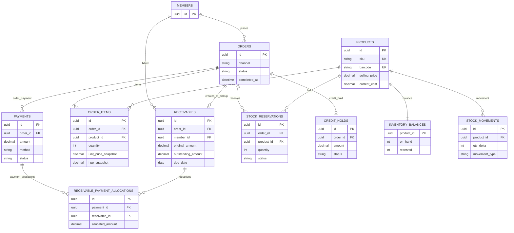
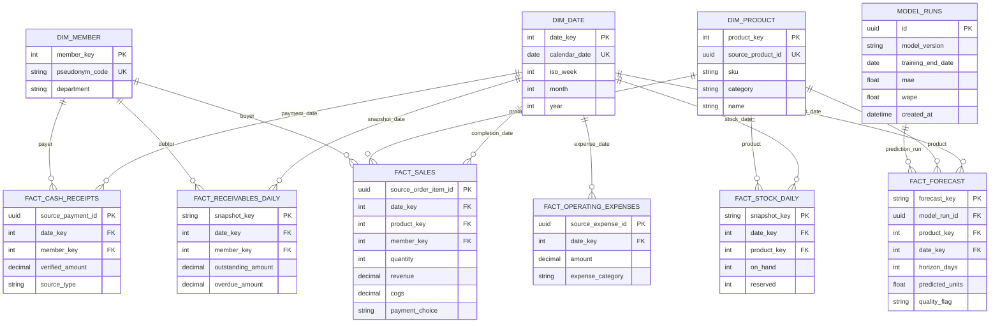

# ERD Database KOPERADATA v1.4 — PostgreSQL OLTP & Data Warehouse

**Status:** Baseline desain logis untuk implementasi tim 5 PIC, turunan PRD v1.4.  
**Lingkup:** 3 role RBAC (`MEMBER`, `CASHIER`, `MANAGER`), transaksi pickup/POS, barcode, stok, HPP, Excel, piutang **limit global / 7 hari / pelunasan lewat kasir**, ETL dan ML.  
**Cara melihat:** GitHub/VS Code dengan dukungan Mermaid atau [Mermaid Live](https://mermaid.live/) untuk kode diagram. Diagram mengutamakan hubungan inti; migrasi SQL wajib mengikuti constraint pada bagian bawah dokumen.

## 1. Skema konseptual dan kepemilikan

| Domain | Nama skema | Pemilik | Arah akses |
|---|---|---|---|
| OLTP | `public` | B (core), C (master) | Laravel read/write melalui Services |
| Data warehouse | `analytics` | D | Spark/ETL write, dashboard read |
| Prediksi | `analytics` | E + D review | ML write lewat kontrak forecast, dashboard read |
| Raw data / staging file | private storage / MinIO | C, D | file privat, ETL terkontrol |

> Satu database PostgreSQL boleh memiliki dua schema (`public` dan `analytics`). **Tidak membuat database berbeda per PIC.** Perubahan stok/piutang **bukan** tugas ETL.

## 2. ERD OLTP menyeluruh

```mermaid
erDiagram
    USERS ||--o{ USER_ROLES : has
    ROLES ||--o{ USER_ROLES : assigned
    USERS ||--o| MEMBERS : member_profile
    USERS ||--o{ AUDIT_LOGS : performs
    MEMBERS ||--o{ ORDERS : places
    MEMBERS ||--o| MEMBER_CREDIT_ACCOUNTS : credit_status
    MEMBERS ||--o{ CREDIT_HOLDS : reserves_credit
    MEMBERS ||--o{ RECEIVABLES : owes
    CREDIT_POLICIES ||--o{ CREDIT_POLICY_LOGS : revisions
    ORDERS ||--|{ ORDER_ITEMS : contains
    ORDERS ||--o{ PAYMENTS : receives
    ORDERS ||--o{ STOCK_RESERVATIONS : reserves
    ORDERS ||--o| CREDIT_HOLDS : credit_commitment
    ORDERS ||--o| RECEIVABLES : creates_receivable
    RECEIVABLES ||--o{ RECEIVABLE_PAYMENT_ALLOCATIONS : receives_allocations
    PAYMENTS ||--o{ RECEIVABLE_PAYMENT_ALLOCATIONS : allocates
    CATEGORIES ||--o{ PRODUCTS : categorizes
    PRODUCTS ||--|| INVENTORY_BALANCES : current_balance
    PRODUCTS ||--o{ PRODUCT_PRICE_HISTORIES : repriced
    PRODUCTS ||--o{ ORDER_ITEMS : ordered
    PRODUCTS ||--o{ STOCK_RESERVATIONS : stock_held
    PRODUCTS ||--o{ STOCK_MOVEMENTS : stock_ledger
    SUPPLIERS ||--o{ PURCHASE_RECEIPTS : delivers
    PURCHASE_RECEIPTS ||--|{ RECEIPT_ITEMS : has
    PRODUCTS ||--o{ RECEIPT_ITEMS : received
    IMPORT_BATCHES ||--o{ IMPORT_ROWS : stages
    IMPORT_ROWS ||--o{ IMPORT_ERRORS : validation_errors
    USERS ||--o{ OPERATING_EXPENSES : records

    USERS {
        uuid id PK
        string email UK
        string password_hash
        string status
    }
    ROLES {
        string code PK
        string name
    }
    USER_ROLES {
        uuid user_id PK,FK
        string role_code PK,FK
    }
    MEMBERS {
        uuid id PK
        uuid user_id FK
        string employee_number UK
        string member_number UK
        string full_name
        string department
        string status
    }
    CATEGORIES {
        uuid id PK
        string name
    }
    PRODUCTS {
        uuid id PK
        uuid category_id FK
        string sku UK
        string barcode UK
        string name
        decimal selling_price
        decimal current_cost
        int reorder_point
        boolean is_active
    }
    PRODUCT_PRICE_HISTORIES {
        uuid id PK
        uuid product_id FK
        decimal old_cost
        decimal new_cost
        decimal old_sell_price
        decimal new_sell_price
        uuid changed_by FK
        datetime changed_at
    }
    SUPPLIERS {
        uuid id PK
        string name
        int lead_time_days
    }
    PURCHASE_RECEIPTS {
        uuid id PK
        uuid supplier_id FK
        datetime received_at
        string status
    }
    RECEIPT_ITEMS {
        uuid id PK
        uuid receipt_id FK
        uuid product_id FK
        int quantity
        decimal unit_cost
    }
    INVENTORY_BALANCES {
        uuid product_id PK,FK
        int on_hand
        int reserved
        datetime updated_at
    }
    STOCK_MOVEMENTS {
        uuid id PK
        uuid product_id FK
        int qty_delta
        string movement_type
        string source_ref
        datetime occurred_at
    }
    ORDERS {
        uuid id PK
        uuid member_id FK
        string channel
        string status
        string payment_choice
        string pickup_code UK
        datetime completed_at
    }
    ORDER_ITEMS {
        uuid id PK
        uuid order_id FK
        uuid product_id FK
        int quantity
        decimal unit_price_snapshot
        decimal hpp_snapshot
    }
    STOCK_RESERVATIONS {
        uuid id PK
        uuid order_id FK
        uuid product_id FK
        int quantity
        string status
    }
    PAYMENTS {
        uuid id PK
        uuid order_id FK
        uuid member_id FK
        decimal amount
        string method
        string status
        datetime verified_at
    }
    CREDIT_POLICIES {
        uuid id PK
        decimal limit_amount
        int due_days
        boolean is_active
        datetime effective_at
    }
    CREDIT_POLICY_LOGS {
        uuid id PK
        uuid policy_id FK
        decimal old_limit
        decimal new_limit
        uuid changed_by FK
        datetime changed_at
    }
    MEMBER_CREDIT_ACCOUNTS {
        uuid member_id PK,FK
        string status
        datetime activated_at
    }
    CREDIT_HOLDS {
        uuid id PK
        uuid order_id FK,UK
        uuid member_id FK
        decimal amount
        string status
    }
    RECEIVABLES {
        uuid id PK
        uuid order_id FK,UK
        uuid member_id FK
        decimal original_amount
        decimal outstanding_amount
        date due_date
    }
    RECEIVABLE_PAYMENT_ALLOCATIONS {
        uuid id PK
        uuid payment_id FK
        uuid receivable_id FK
        decimal allocated_amount
    }
    OPERATING_EXPENSES {
        uuid id PK
        uuid created_by FK
        date expense_date
        decimal amount
        string category
    }
    IMPORT_BATCHES {
        uuid id PK
        uuid uploaded_by FK
        string checksum
        string import_type
        string status
        datetime cutoff_at
    }
    IMPORT_ROWS {
        uuid id PK
        uuid batch_id FK
        int row_number
        string row_status
        string source_key
    }
    IMPORT_ERRORS {
        uuid id PK
        uuid import_row_id FK
        string field_name
        string error_code
    }
    AUDIT_LOGS {
        uuid id PK
        uuid actor_user_id FK
        string action
        string entity_type
        string entity_id
        datetime occurred_at
    }
```

**Keterangan keterbatasan notasi:** `ORDERS.member_id` bersifat `NULL` hanya untuk POS nonanggota yang **lunas**; `PAYMENTS.order_id` boleh `NULL` untuk pembayaran cicilan yang dialokasikan ke banyak piutang. FK tambahan seperti `changed_by`, `verified_by`, `uploaded_by`, `confirmed_by` mengarah ke `USERS`, tetapi tidak digambar semua agar diagram terbaca. `ROLES.code` bernilai tepat tiga role; `MEMBER_CREDIT_ACCOUNTS` **tidak punya** nominal limit individual.

## 3. ERD fokus penjualan, inventaris, piutang

### Siklus transaksi yang mengubah database

| Peristiwa | Tabel berubah | Aturan atomik |
|---|---|---|
| Checkout `CASH/TRANSFER` | `orders`, `order_items`, `stock_reservations`, `inventory_balances.reserved` | `on_hand` tidak berubah |
| Checkout `CREDIT` | di atas + `credit_holds` | lock member credit + produk, limit global - outstanding - holds >= nominal |
| Verifikasi pembayaran sebelum pickup | `payments` | uang masuk tercatat, tetapi penjualan belum `COMPLETED` |
| Konfirmasi pickup normal | `orders`, `inventory_balances`, `stock_reservations`, `stock_movements`, snapshot HPP | payment VERIFIED, stok fisik turun sekali |
| Pickup kredit | di atas + `credit_holds`, `receivables` | hold dilepas; receivable dibuat saat serah terima, due 7 hari |
| POS langsung | order POS + items + payment/receivable + movement + balance | satu transaksi, barang diserahkan langsung |
| Cicilan kasir VERIFIED | `payments`, `receivable_payment_allocations`, `receivables` | outstanding turun; **omzet tidak berubah** |
| Cancel sebelum pickup | order + stok reservation + credit hold | on_hand tetap; refund bila sudah dibayar |

## 4. ERD Data Warehouse (Star Schema)

### Grain dan pembatasan agregasi

| Fact | Satu row mewakili | Aturan agregasi |
|---|---|---|
| `fact_sales` | **1 order_item** yang `COMPLETED` | SUM qty/revenue/cogs lintas tanggal dan produk valid |
| `fact_cash_receipts` | **1 verified payment** | SUM pembayaran pada tanggal verifikasi; pelunasan lama bukan penjualan baru |
| `fact_stock_daily` | **1 SKU per snapshot date** | stok per tanggal; **jangan** SUM lintas tanggal |
| `fact_receivables_daily` | **1 member per snapshot date** | saldo per tanggal; **jangan** SUM lintas tanggal |
| `fact_operating_expenses` | **1 expense yang valid** | SUM nilai sesuai tanggal biaya |
| `fact_forecast` | **1 product + target date + forecast run** | per run; jangan SUM beberapa versi model untuk target sama |

`fact_sales` untuk POS nonanggota boleh menggunakan `member_key` sentinel seperti `UNKNOWN_MEMBER`, bukan membuat identitas pegawai fiktif. Dimensi produk yang berubah kategori/harga harus memiliki strategi historisasi konsisten; harga/HPP transaksi berasal dari snapshot item, bukan harga master terkini.

## 5. Data dictionary dan constraint kritis

### RBAC dan anggota

| Tabel | Constraint utama | Catatan |
|---|---|---|
| `roles` | CHECK code IN (`MEMBER`,`CASHIER`,`MANAGER`) | tidak ada `ADMIN` |
| `user_roles` | PK (`user_id`,`role_code`) | satu akun boleh multi-role |
| `members` | UNIQUE `employee_number`, `member_number`; `user_id` unique jika ada | member harus aktif untuk checkout/kredit |

### Produk, stok, harga dan import

| Tabel | Constraint utama | Catatan |
|---|---|---|
| `products` | UNIQUE SKU, UNIQUE barcode jika non-NULL, price/cost >= 0 | ada harga jual dan HPP acuan |
| `inventory_balances` | PK = product_id, `on_hand >= reserved >= 0` | balance boleh diedit hanya melalui inventory service |
| `stock_reservations` | qty > 0, referensi order+product | active reserve tidak melebihi stok fisik |
| `stock_movements` | qty_delta bukan 0, source reference untuk idempotency | audit penerimaan/pickup/POS/koreksi |
| `order_items` | qty > 0, price snapshot >= 0, cost snapshot nullable sampai completed | jangan edit setelah completed |
| `product_price_histories` | actor, before/after, timestamp, alasan | hanya Manager pricing |
| `import_batches` | checksum dan source/type uniqueness sesuai kebijakan | file lama tidak boleh double count |
| `import_rows` | UNIQUE (`batch_id`, `row_number`) | staging, error per field |

### Pembayaran, piutang dan limit global

| Tabel | Constraint utama | Catatan |
|---|---|---|
| `credit_policies` | limit >= 0, `due_days=7`, **tepat satu active** | nilai limit global belum dipilih |
| `member_credit_accounts` | PK `member_id`, status ACTIVE/BLOCKED | **tanpa individual limit** |
| `credit_holds` | UNIQUE `order_id`, amount >= 0 | dibuat checkout, dilepas pickup/batal |
| `receivables` | UNIQUE `order_id`, original/outstanding >= 0 | timbul saat completed, due pickup +7 hari |
| `payments` | amount >0, status verified/rejected/pending; referensi transfer terverifikasi dedupe | order_id boleh NULL untuk cicilan multi-tagihan |
| `receivable_payment_allocations` | allocated >0, FK payment/receivable, UNIQUE (`payment_id`,`receivable_id`) | hanya efektif jika payment VERIFIED |
| `orders` | valid channel `ONLINE_PICKUP`/`POS`; valid status; pickup_code unique nullable | POS nonmember hanya lunas |

**Aturan concurrency:** row lock akun kredit saat cek outstanding + hold, dan row lock stok per SKU; lock dalam urutan konsisten; semua mutasi lintas entitas selesai atomik dan punya idempotency key. CHECK/UNIQUE FK tidak cukup untuk menghitung agregat limit secara paralel tanpa lock.

**Jatuh tempo:** pickup/POS `2026-11-16` waktu lokal → `due_date=2026-11-23`; tagihan belum lunas melewati akhir 23 November → OVERDUE sejak 24 November waktu Asia/Jakarta. Keterlambatan adalah hasil derivasi dari tanggal + saldo, bukan status string stale.

## 6. Index dan integritas yang direkomendasikan

- `products(sku)` unique, `products(barcode)` unique partial where barcode is not null.
- `orders(member_id, created_at)`, `orders(status, completed_at)`, `orders(pickup_code)` unique bila tidak null.
- `order_items(order_id)`, `order_items(product_id)`.
- `payments(status, verified_at)`, `payments(member_id, verified_at)`, unique payment `idempotency_key` scoped serta transfer reference jika tersedia.
- `receivables(member_id, due_date)` where outstanding > 0, unique receivables `order_id`.
- `credit_holds(member_id, status)` untuk penjumlahan active holds.
- `stock_reservations(product_id, status)`, `stock_movements(product_id, occurred_at)`.
- `import_batches(checksum, import_type)` dan `import_rows(batch_id,row_number)`.
- `analytics.fact_sales(date_key, product_key)`; `analytics.fact_receivables_daily(date_key, member_key)`; `analytics.fact_forecast(product_key,date_key,model_run_id)`.

## 7. Penanggung jawab migrasi database

1. **PIC B:** auth, RBAC, order, payment, POS, credit policy/hold, receivable/allocations, inventory balances/ledger, audit/idempotency.
2. **PIC C:** master member/product/category/supplier, pricing histories, receipt, expense, Excel staging. **Migrasi C direview B** untuk FK dan konsistensi stok.
3. **PIC D:** semua dimensi dan fakta schema `analytics` serta `etl_runs`, akses warehouse.
4. **PIC E:** tabel `model_runs`/`fact_forecast` bersama D (review skema D); tidak mengubah tabel transaksi.
5. **PIC A:** tidak membuat migrasi untuk angka saldo atau business state.

## 8. Checklist sebelum ERD dijadikan migration

- [ ] Keputusan nilai limit global masih berupa konfigurasi, **tidak** hardcoded.
- [ ] Tiga RBAC saja; multi-role diperbolehkan.
- [ ] Semua entity memiliki ID/FK, actor, timestamps dan constraints yang diperlukan.
- [ ] `stock_reservations` & `credit_holds` terikat satu order; release tidak boleh 2x.
- [ ] `order_items` mengunci harga checkout dan HPP completion.
- [ ] Pembayaran terverifikasi menjadi sumber kas; `receivables` sumber saldo piutang.
- [ ] Lookup barcode uniquely maps to product, manual fallback tetap mungkin.
- [ ] Import cut-off tidak mengubah stok saat replay histori.
- [ ] Tidak menjumlah snapshot across dates; faktual analytic grain benar.
- [ ] Uji rollback, idempotency dan referential integrity lewat migration & integration tests.

**Catatan desain:** ERD ini adalah model **logis**. Sebelum implementasi, PIC B/C/D menetapkan tipe kolom, `ON DELETE` policy (umumnya RESTRICT untuk transaksi historis), data seeding, daftar enum, serta indeks SQL final. Hindari cascade delete pada pesanan, pembayaran, stok ledger dan piutang: nonaktifkan entitas atau gunakan koreksi ter-audit.
