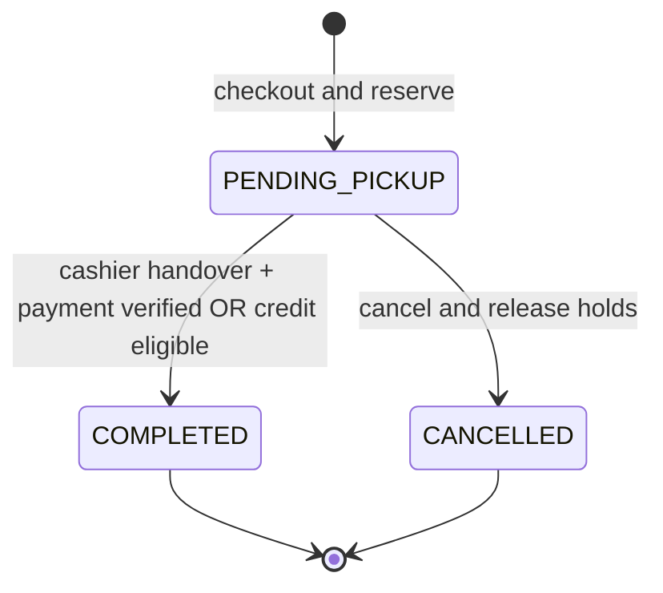

# PIC B — Backend Core, Inventory, POS, Pembayaran & Piutang

**Pemilik:** Anggota tim 2  
**Area:** Sumber kebenaran transaksi PostgreSQL + aturan bisnis Laravel  
**Reviewer wajib:** Seluruh perubahan transaksi/kredit/stok dari PIC lain diperiksa PIC B.

## 1. Misi utama

Membangun **domain transaksi yang aman, atomik dan auditable**: login & tiga RBAC, pesanan pickup, POS dengan lookup barcode, pembayaran, reservasi dan pengurangan stok, kebijakan piutang global dan cicilan.

**Larangan desain:** tidak boleh ada logika stok atau piutang yang diimplementasikan ulang oleh PIC A/C/D/E. Semua mutasi saldo melalui service milik PIC B.

## 2. Entity dan tabel milik PIC B

- `users`, `roles`, `user_roles` (koordinasi atribut anggota dengan PIC C).
- `orders`, `order_items`, `payments`, `payment_verifications` (opsional sebagai audit), `receivables`, `receivable_payment_allocations`.
- `inventory_balances`, `stock_reservations`, `stock_movements`.
- `credit_policies`, `credit_policy_logs`, `member_credit_accounts`, `credit_holds`.
- `idempotency_records`, `audit_logs` untuk operasi domain kritis; nama final divalidasi bersama lewat migrations.

Tabel `members`, `products`, `product_price_histories`, `purchase_receipts` dimiliki bersama PIC C, tetapi PIC B mendefinisikan FK ke domain transaksi dan service `InventoryService` yang wajib dipakai PIC C.

## 3. Struktur service yang disarankan

```text
apps/web/app/
├── Http/Controllers/Api/V1/{Order,POS,Payment,Pickup,Credit,Inventory}Controller.php
├── Http/Requests/{Checkout,CompletePickup,CreatePosSale,RecordPayment}Request.php
├── Policies/{Order,MemberCredit,Payment,Inventory}Policy.php
├── Services/
│   ├── Orders/{CheckoutService,PickupService,CancelOrderService}.php
│   ├── Inventory/{InventoryService,ReservationService}.php
│   ├── Payments/{PaymentService,PaymentVerificationService}.php
│   ├── Credit/{CreditEligibilityService,CreditHoldService,ReceivableService}.php
│   └── POS/PosSaleService.php
├── Enums/{OrderStatus,PaymentStatus,PaymentMethod}.php
└── Events/{OrderCompleted,ReceivablePaid}.php
```

Service berada di Laravel; controller tipis; event untuk ETL/notifications hanya dipublikasikan **setelah commit** dan tidak boleh membuat keberhasilan penjualan tergantung Spark.

## 4. Checklist implementasi

### Fondasi dan RBAC

- [ ] **B-01** Migrasi dan seeder untuk `MEMBER`, `CASHIER`, `MANAGER` saja. Multi-role memakai `user_roles`; tidak ada `ADMIN`.
- [ ] **B-02** Login/session, middleware/Policies, ownership anggota, policy HPP-only manager, cashier scoped receivables.
- [ ] **B-03** Migrasi FK/INDEX/UNIQUE/CHECK; money decimal, qty integer; audit actor/timestamps.

### Inventory + pemesanan

- [ ] **B-04** `InventoryService`: receipt, adjust, reserve, release, fulfill; ledger `stock_movements`; invariant `on_hand >= reserved >= 0`.
- [ ] **B-05** Checkout pickup only: order items snapshot harga jual, reserve stok dalam transaksi, idempotency key.
- [ ] **B-06** Pembayaran order tunai/transfer: belum verified ≠ paid; bila pembayaran sebelum pickup catat uang muka/kas dan **belum** omzet.
- [ ] **B-07** Konfirmasi pickup: validasi order/code, pembayaran VERIFIED atau credit eligible+hold, stok berkurang dan stock reserve lepas, COGS snapshot, order selesai, receivable hanya jika ada saldo belum bayar.
- [ ] **B-08** Pembatalan order belum pickup: lepas reservasi/hold, refund jika sudah dibayar melalui prosedur; tidak buat tagihan atau penjualan.
- [ ] **B-09** POS pembelian langsung: lookup barcode oleh API, harga dari DB, serah terima+stok+penjualan sekali commit; POS nonanggota wajib lunas.

### Kredit global dan cicilan

- [ ] **B-10** `credit_policies`: hanya satu active global limit yang ditetapkan manager, `due_days=7` locked di MVP, semua perubahan audit.
- [ ] **B-11** `member_credit_accounts`: status ACTIVE/BLOCKED per anggota, tidak menyimpan limit individual.
- [ ] **B-12** Credit eligibility: member aktif, fasilitas aktif, tidak overdue (berdasarkan due_date lokal & saldo), outstanding+active holds+pesanan baru <= global limit.
- [ ] **B-13** Checkout `CREDIT` membuat `credit_holds` seiring stock reserve; gunakan lock tingkat anggota saat menghitung agregat kredit.
- [ ] **B-14** Saat pickup/POS selesai: credit hold dilepas, tagihan `receivables` dibuat **tepat sekali**, `due_date=pickup_date(Asia/Jakarta)+7 hari kalender`.
- [ ] **B-15** Cicilan via kasir tunai/transfer, alokasi lintas tagihan; verifikasi transfer dulu sebelum saldo berkurang; cek sum alokasi dan tidak overpay.
- [ ] **B-16** Riwayat kredit/aging: status OVERDUE derived, tunggakan memblokir order `CREDIT`, tidak memblokir CASH/TRANSFER.
- [ ] **B-17** Handle concurrent checkout credit/stock, double-click pickup, payment retry dan rollback setelah kegagalan.

## 5. State machine dan contoh transaksi



| Kejadian | `on_hand` | `reserved` | Piutang | Omzet |
|---|---|---|---|---|
| Checkout normal/kredit | tidak berubah | bertambah | belum timbul | belum bertambah |
| Bayar sebelum pickup | tidak berubah | tetap | belum timbul | belum bertambah |
| Pickup tunai/transfer lunas | berkurang | dilepas | 0 | bertambah |
| Pickup kredit eligible | berkurang | dilepas | timbul sebesar saldo belum lunas | bertambah |
| Cicilan verified sesudah pickup | tetap | tetap | menurun | tidak berubah |
| Batal sebelum pickup | tetap | dilepas | 0 | tidak berubah |

### Deadline kredit

Pickup **16-11-2026** → due **23-11-2026 sampai akhir hari lokal** (`Asia/Jakarta`); dengan saldo >0 pada **24-11-2026** status overdue. Cicilan tidak menggeser tanggal jatuh tempo.

### Atomisitas dan race conditions

- Checkout: lock `member_credit_accounts` (untuk kredit), lalu lock inventory rows dalam urutan SKU/UUID konsisten; catat order, reservation, credit hold, idempotency dalam transaksi.
- Pickup: lock order + reservation + inventory + hold, cek kondisi pembayaran/kredit, snapshot HPP, catat sale completion, receivable & movement; commit bersama.
- POS: lock inventory (dan credit member bila kredit), validasi, catat order/items/payment/receivable/stock movement dalam satu transaction.
- Cicilan: lock payment, receivable(s), validasi sum, alokasikan hanya setelah VERIFIED; idempotent atas `idempotency_key`.
- Gunakan unique `receivables.order_id`, `credit_holds.order_id`, `payments.external_reference` (jika valid), idempotency scope unik. Ulangi deadlock secara terbatas di service.

## 6. API yang menjadi tanggung jawab

**Prefix `/api/v1`; seluruh endpoint JSON + auth + RBAC**.

| Method | Path | Akses | Aturan |
|---|---|---|---|
| POST | `/orders` | Member | reserve stok (+ credit hold jika CREDIT) |
| GET | `/orders/my` | Member | owner-only |
| GET | `/cashier/orders` | Cashier/Manager | antrean pickup |
| POST | `/orders/{id}/payments` | Cashier/Manager | catat cash/transfer |
| POST | `/payments/{id}/verify` | Cashier/Manager | verifikasi cash/transfer |
| POST | `/orders/{id}/confirm-pickup` | Cashier/Manager | fulfill atomik |
| POST | `/orders/{id}/cancel` | Cashier/Manager | release + refund workflow |
| POST | `/pos/sales` | Cashier/Manager | fulfill langsung, barcode/input manual |
| GET | `/products/lookup?barcode=` | Cashier/Manager | resolve SKU dari master C |
| GET | `/members/me/credit` | Member | policy global + saldonya |
| GET | `/members/me/receivables` | Member | own only |
| GET | `/cashier/receivables?member_id=...` | Cashier/Manager | pelayanan |
| POST | `/receivables/payments` | Cashier/Manager | cicilan/alokasi |
| GET/PATCH | `/credit-policy` | Manager | global limit, due=7 |
| PATCH | `/members/{id}/credit-status` | Manager | active/blocked, no individual limit |

Buat spesifikasi OpenAPI dan response contoh (termasuk error codes) di `contracts/api/` sebelum PIC A mengintegrasikan UI.

## 7. Invariant dan constraint database

- `inventory_balances.on_hand >= 0`, `reserved >= 0`, `reserved <= on_hand`.
- `payments.amount > 0`, `receivables.original_amount >= 0`, `outstanding_amount >= 0`, `allocations.amount > 0`.
- `credit_policies.limit_amount >= 0`, `credit_policies.due_days = 7`; tepat satu kebijakan aktif (partial unique/singleton enforced).
- `receivables.order_id` dan `credit_holds.order_id` unik. `orders.member_id IS NULL` hanya untuk POS **lunas** nonanggota.
- Setiap pengurangan stok punya `stock_movements` + alasan/referensi. Total reserve aktif harus konsisten dengan agregat reservation aktif.
- Harga jual item terkunci saat checkout; HPP snapshot ditetapkan pada transaksi completed sesuai metode akuntansi yang diputuskan bersama C.

## 8. Pengujian wajib

- [ ] **B-T01** Checkout 5 dari stok 100 -> physical 100, reserve 5, available 95.
- [ ] **B-T02** 2 checkout paralel stok terakhir -> hanya satu berhasil.
- [ ] **B-T03** Credit global limit dengan 2 checkout paralel -> outstanding + hold tidak melewati limit.
- [ ] **B-T04** Pickup kredit idem dipanggil 2x -> hanya 1 stok keluar, 1 revenue, 1 receivable.
- [ ] **B-T05** Credit overdue pada 24 November untuk due 23 November -> ditolak, cash boleh.
- [ ] **B-T06** Cicilan 75k dari 200k -> outstanding 125k; omzet tetap; cash masuk ketika verified.
- [ ] **B-T07** Transfer PENDING tidak mengurangi saldo tagihan.
- [ ] **B-T08** Kasir tidak dapat mengubah limit global/harga/HPP, Member tidak bisa membaca orang lain.
- [ ] **B-T09** Rollback exception setelah beberapa query -> semua stok/saldo/penjualan tetap seperti sebelum aksi.
- [ ] **B-T10** POS scan/manual menggunakan produk yang sama, qty & harga dari backend.

## 9. Deliverable, dependency dan DoD

- Migrasi OLTP versi pertama, seed role, services + API v1, OpenAPI, tests feature/concurrency, dokumentasi status.
- **Butuh dari C:** data master produk/barcode, HPP, migrasi receipts, stok awal dan mapping ID karyawan.
- **Menyediakan untuk A:** kontrak UI order/pembayaran/credit; **untuk D:** read model/event & definisi realized sale.
- **Jangan merge** bila AC kritis stok, limit, due 7 hari, payment verified dan idempotency belum lulus.

**Selesai bila:** semua jalur pembayaran dan pickup/POS aman di bawah concurrency, transaksi dan tagihan tercatat sekali, tanpa ketergantungan ETL.
